# Parliament Chess (Vote King)

**Every move FIDE. Every crown elected.**

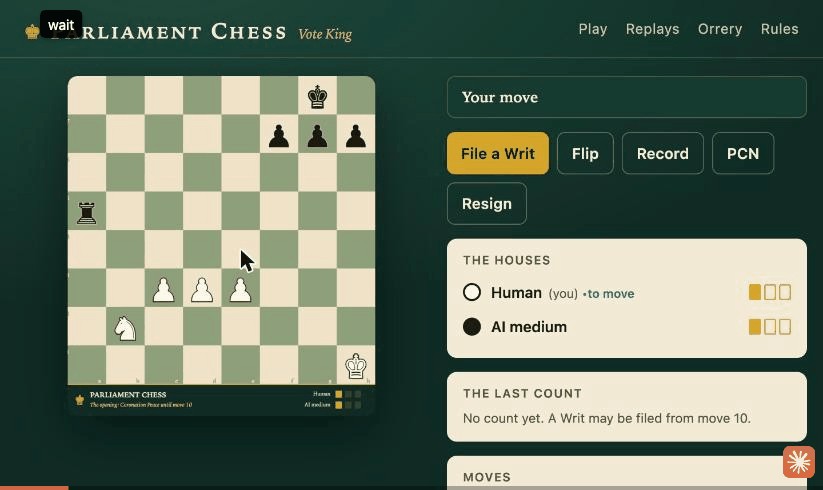

Parliament Chess is chess with one new office: the crown. Halfway through a game you can call an
election, and your own pieces vote on whether the crown should leave your King for another piece.
Win the vote and that piece becomes your King, while the old King steps down to be a humble pawn.
It is a parody in the spirit of Rock Paper Scissors Lizard Spock: the chess is untouched, the
politics are the joke, and the joke is balanced.

**[Website](https://vonglurt.github.io/parliamentchess/)** ·
**[Player's guide video](https://vonglurt.github.io/parliamentchess/media/players_guide.mp4)** (106 s) ·
**[How a neural net plays](https://vonglurt.github.io/parliamentchess/media/net_mind.mp4)** (192 s) ·
**[The net reads the classics](https://vonglurt.github.io/parliamentchess/media/net_classics.mp4)** (film) ·
**[Rules](RULES.md)** · **[Lab reports](docs/parliament-chess-lab-report.md)** · MIT License

**Documentation:** **[Contents](docs/INDEX.md)**, a table of contents for the whole project ·
**[How it works](docs/TECHNICAL.md)**, the technical tour: the engine, the bots, the net, its training and the fleet ·
the website's three doors: **[play it](https://vonglurt.github.io/parliamentchess/guide.html)**,
**[what is this](https://vonglurt.github.io/parliamentchess/about.html)**,
**[the trained net](https://vonglurt.github.io/parliamentchess/net.html)**

## Play in a minute

```bash
git clone https://github.com/vonglurt/parliamentchess.git
cd parliamentchess
make up          # then open http://localhost:8080 and press Play now
```

You need PHP 8.2 or later and nothing else. `make down` stops the server.

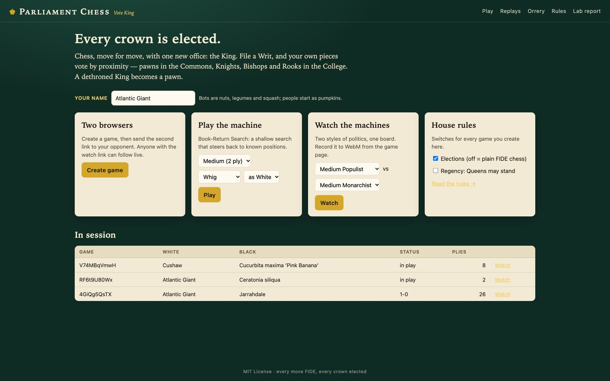

You arrive as a pumpkin or another giant squash (Atlantic Giant, Big Max, Jarrahdale ...); type a new
name if you like. Then pick a way to play:

| | |
| --- | --- |
| **Two browsers** | Create a game and send the second link to a friend. Anyone with the watch link can follow live. |
| **Play the machine** | Easy, Medium or Hard, as a Whig, a Populist or a Monarchist, with either colour. |
| **Play the neural net** | The champion of the training runs, with its mind drawn beside the board on every move. Or press **Watch it think**. |
| **The classics** | Famous short games, move for move; the net reads every move and says what it would have played. |
| **Watch the machines** | Two bots argue it out while you watch. |

[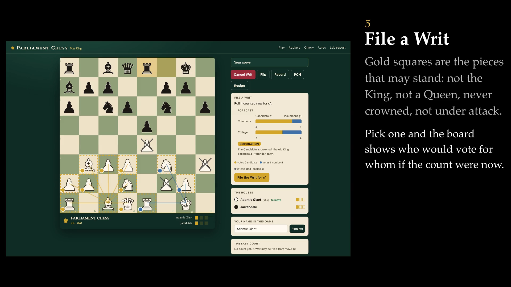](https://vonglurt.github.io/parliamentchess/media/players_guide.mp4)

## How a game goes

### 1. It's chess

Every move is a normal chess move: castling, en passant, promotion, all of it. Fool's Mate still
mates. For the first nine moves nothing else can happen (the *Coronation Peace*), so your openings
are safe.

### 2. From move 10, you may file a Writ

On your turn, instead of moving, press **File a Writ** and name a **Candidate**: one of your own
pieces that could be King instead. It can't be your King or a Queen, it can't have worn the crown
before, and it can't be under attack. The gold squares show who may stand. Pick one, and the board
previews the vote as it stands right now. Filing costs your whole turn.

<p>
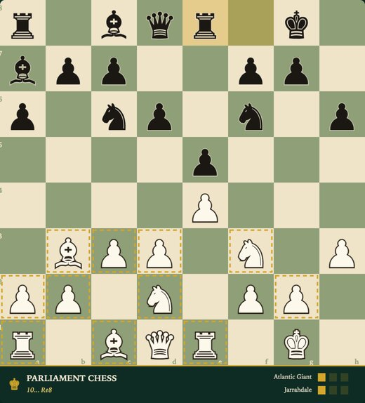
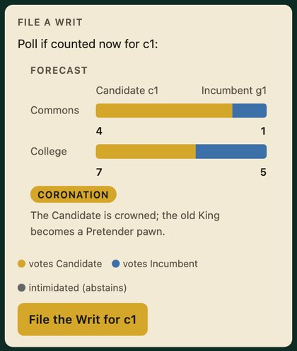
</p>

### 3. The campaign: your opponent gets one move

They can attack the Candidate's square, which makes the election fail. They can capture your voters,
or attack them so they're too scared to vote. Or they can ignore you and file a Writ of their own.

### 4. The count

At the start of your next turn, your pieces vote. Each one backs whichever is **nearer**, the
Candidate or the King, counting king-steps; a tie backs the King. A piece under attack abstains.

- **Commons:** every pawn has 1 vote.
- **College:** a Knight has 2, a Bishop 2, a Rook 3.
- **Speaker:** the Queen votes only to break a tie in the College.

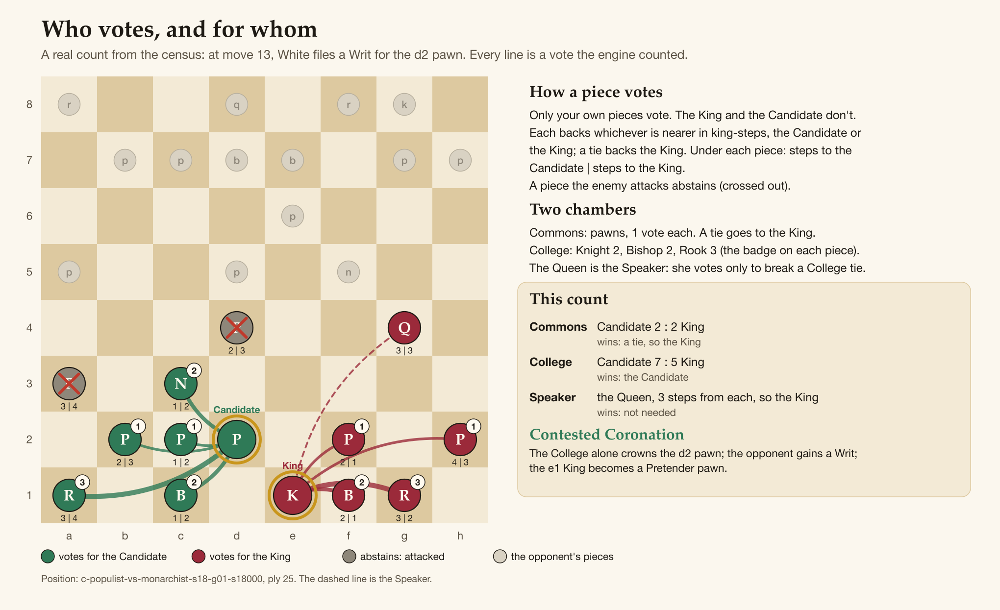

| | Commons back the Candidate | Commons back the King |
| --- | --- | --- |
| **College backs the Candidate** | **Coronation:** the Candidate is King, the old King becomes a pawn | **Contested Coronation:** the same, and your opponent gets a bonus Writ |
| **College backs the King** | **Royal Swap:** King and Candidate swap squares | **Defeat:** nothing happens |

A result that would leave your new King in check, or give check, doesn't count. When the crown
moves, you lose your castling rights. Then you play your move as usual.

## A king vote, step by step

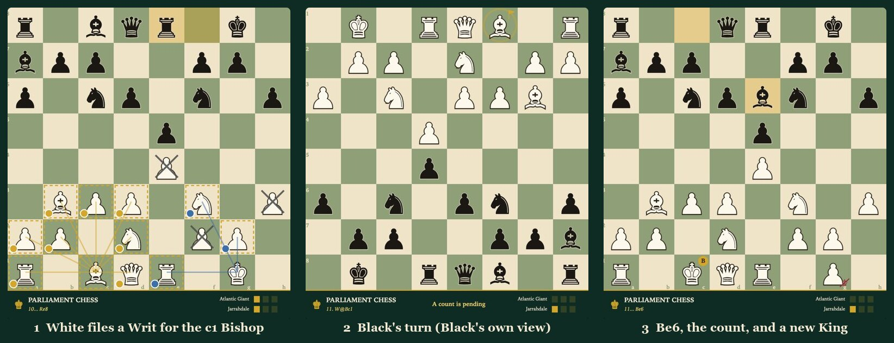

This is a real game from the player's guide, an Italian opening.

1. **Move 11.** White's King sits on g1, so White files a Writ for the Bishop on c1. The preview looks
   comfortable: the a2, b2, c3 and d3 pawns back c1 (Commons 4 to 1), and the a1 Rook, the b3 Bishop
   and the d2 Knight outvote the e1 Rook and the f3 Knight (College 7 to 5).
2. **Black has one move,** and finds a clever one: **Be6**, attacking the Bishop on b3.
3. **The count.** The b3 Bishop is under attack, so it abstains. That takes 2 votes away and leaves
   the College tied at 5 to 5. The Queen on d1 is nearer c1 than g1, so as Speaker she breaks the tie
   for the Candidate. With the Commons already 4 to 1, it's a **Coronation**. The Bishop on c1 is the
   new King (its badge says it was born a Bishop), and the old King on g1 is now a Pretender pawn.
   It looks like castling queenside, done by election.

<p>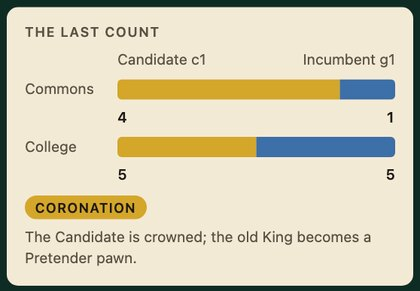</p>

## Writs, terms and the Ledger

- **Writs:** you start with 1. Each time you lose a Knight, Bishop, Rook or Queen you gain 1 (a
  *grievance*), up to 3. A Contested Coronation hands your opponent one too.
- **Terms:** after a count you wait 5 full moves before your next Writ. No Writ while in check, and
  one election at a time.
- **One term only:** a piece that has worn the crown can never be elected again. The starting Kings
  already have.
- **Pretenders:** a dethroned King becomes a pawn, and it may only ever promote to a Rook, Bishop or
  Knight.
- **Stranded pawns:** a pawn put on its last rank by an election can't move, but it still votes. A
  pawn on its own first rank steps one square, never two.

**Winning** is plain chess: checkmate whoever wears the crown. A mate delivered during your opponent's
campaign only counts after their count, because the count may carry the crown out of the net.

## Tips: when to move the crown

Like castling, the crown move has a right moment. In 1,712 Writs from 1,100 self-play games:

1. **Count first.** File a Writ only when the preview already wins it: those moved the crown 79% of
   the time, the rest 5.5%.
2. **Crown before the storm.** With no square around your King attacked, 85% succeeded; with three or
   more attacked, 51%.
3. **Crown early.** Moves 10 to 29: 76%. Move 45 or later: 60%.
4. **Guard your voters.** Like Be6 above, the reply that wins is usually an attack on a voter, not on
   the Candidate.

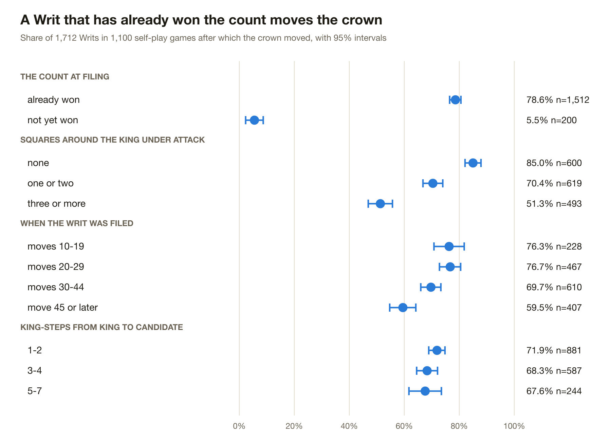

## Play the neural net

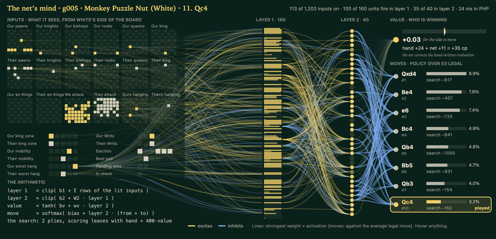

The lobby's **Play the neural net** card puts you against the champion: generation 5, which beat
plain Medium 57% of the time over 200 games. Every time it moves, the panel under the board (or
beside it: **Side by side**) draws what it computed, and animates it from left to right:

1. **It sees 1,203 switches**, each on or off, always from the side to move: eighteen little boards
   (where every piece stands, its former Kings, every square each side attacks, every piece left
   hanging) and 51 summaries (pressure on each King, mobility, the worst piece hanging, Writs in
   hand, whether a Writ may be filed and how the best Candidate would poll, check). About 90 are on.
2. **Layer 1, 160 units.** Each lit switch adds its row of learned weights; a unit whose sum is above
   zero fires. **Layer 2, 40 units,** mixes them. The lines are the strongest pushes: gold excites, blue
   inhibits.
3. **Two heads answer.** The value says who is winning (a correction to the hand-written evaluation,
   in centipawns). The policy scores every legal move; the bars are its percentages.
4. **A search decides.** Two moves deep, it tries the policy's favourites first and scores every
   position it reaches with the hand evaluation plus the net's correction. The gold row and the gold
   arrow on the board are the move played; blue arrows are the policy's other favourites.

Hover any switch, unit or move to read its numbers; in a game between bots, hovering also holds the
game while you read. To beat it: it sees two moves ahead, so quiet three-move plans and a well-timed
Writ are your weapons, and when *Their worst hang* lights up, it has spotted your loose piece.

**Each side's calculation.** Two cards above the panel show both sides at once. A side played by a
net shows its own calculation. Any other side, you or a bot without a net, is *read* by the game's
net: the net is run on the position that side faced, and the move actually played is marked. Each
card shows the last move and where the net ranked it, the net's value for that side (with hand + net
= total), and a tally over the game: how often that side played the net's favourite, the average
rank and probability of its moves, and the average size of the net's correction. A strip draws the
net's evaluation after every move from White's side (dots for a net's own moves, rings for readings).
Click a card, or **White** / **Black**, to hold the panel on that side; **Both** draws one panel per
side. **Net against net** in the lobby puts the champion on both sides (Populist against Whig).

**Matrix or Network.** *Matrix* (the default) draws the end state of the computation the way the
Orrery console's MIND screen draws its tank nets: black glass and phosphor, every input, unit and
output a square, green for positive, amber for negative, black for zero. Each unit is framed in its
own colour and a wire wears its source's colour, dotted when it inhibits. Layer 1's 160 units
are a 20 × 8 grid and layer 2's 40 an 8 × 5. The move squares are coloured by the search's score, and
a white frame marks the move played. On the right, *decisions* shows the game so far, one column a
move: the net's value, how it ranked the move played, its correction, who chose (net, person, bot,
book) and what happened (count, Writ, capture, check). *Network* is the same numbers animated with
curves. `?panel=matrix|network` and `?view=both` set them from a link. The same end state sits in the sidebar beside
the board (**MIND**, under the status line) for whichever move was played last: the inputs, both
layers, the moves' activations as squares with their probabilities, and the decisions strip.

[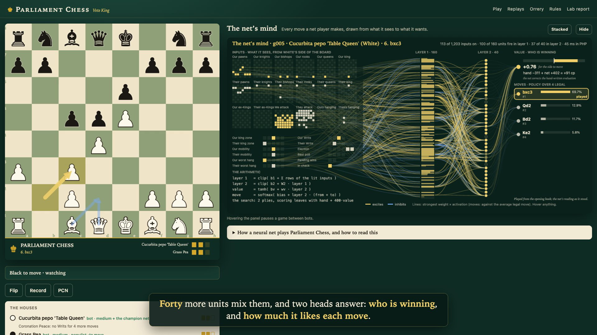](https://vonglurt.github.io/parliamentchess/media/net_mind.mp4)

## The classics through its eyes

Every move of six famous short games is legal Parliament Chess (no Writ before move 10, and none is
ever forced), so the champion can read them: Fool's and Scholar's Mate, Légal 1750, the Opera Game 1858,
Réti–Tartakower 1910 and Lasker–Thomas 1912. In the lobby, **The classics** replays any of them with the
net reading every move and saying what it would have played; `sh bin/php tools/classics.php` measures all
113 positions (`docs/data/classics.json`).

| Over the winners' 59 moves | Played history's move |
| --- | --- |
| The policy's first hunch (its favourite move) | 6 (10%) |
| Medium, the hand-written player, 2 plies | 25 (42%) |
| **The net, as the lobby plays it, 2 plies** | **31 (53%)** |
| The same net, 3 plies | 34 (58%) |

It finds every final mate and Morphy's 16.Qb8+!! (a check, so the search sees one ply further), rejects
Scholar's 3...Nf6?? even though its own policy ranks it first, and misses the quiet, deep sacrifices:
Lasker's 11.Qxh7+!! is mate in eight. The film walks through all six:
[The Net Reads the Classics](https://vonglurt.github.io/parliamentchess/net.html#film).

## How the net was trained

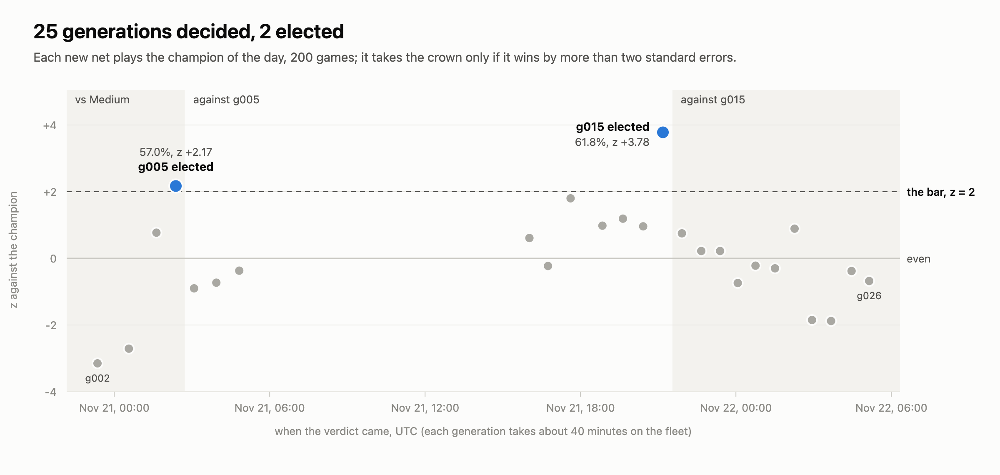

A generation is a chain of Orrery jobs on the fleet: 30 label jobs (a teacher one ply deeper scores
every position), one training job on a GPU, a 200-game gauntlet against the champion, and a verdict.
A challenger is elected only if it wins by more than two standard errors; generation 5 beat plain
Medium, and generation 15 beat generation 5, 61.8%. The queue, the timeline, where the time goes and
how training stops are on [the net's page](https://vonglurt.github.io/parliamentchess/net.html#queue) and in
[How it works](docs/TECHNICAL.md#5-training); `python3 tools/fig_training.py` redraws the figures from
`docs/data/generations.json` after each verdict.

## Your game, on the record

<p>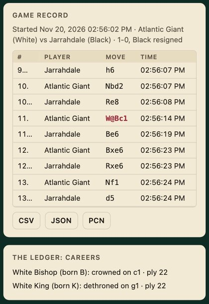
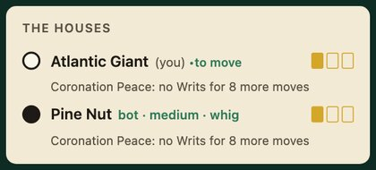</p>

The side panel lists every move with its player and the time it was played, during the game and after
it, and **CSV**, **JSON** and **PCN** download the whole record. The Ledger keeps each piece's career:
born a Bishop, crowned on c1. Bots are named after sixty nuts, legumes and squash, by common or Latin
name: you might lose to *Ceratonia siliqua* (the carob) or a Black-eyed Pea.

---

# For developers

- **Lab reports:** [docs/parliament-chess-lab-report.md](docs/parliament-chess-lab-report.md)
  (also as [HTML](docs/parliament-chess-lab-report.html)): Reports I–XIII, from the rules to reading the net's mind.
  The data behind them is in [docs/data](docs/data) and the figures in [docs/media](docs/media)
- **Docs:** [docs/INDEX.md](docs/INDEX.md), the contents; [docs/TECHNICAL.md](docs/TECHNICAL.md), how it works
  (`python3 tools/md2page.py` makes their website pages, `technical.html` and `contents.html`)
- **Films:** `docs/media/net_classics.mp4`, the classics through the net's mind (`sh film/classics.sh`);
  `docs/media/parliament_chess.mp4`, a 3Blue1Brown-style explainer made with Manim;
  `docs/media/players_guide.mp4`, the player's guide (`sh film/render.sh guide`);
  `docs/media/net_mind.mp4`, how a neural net plays, recorded from the live game (`node film/brain_demo.mjs`)
- **Training:** generations of nets train on an Orrery fleet and commit each verdict here
  (`docs/data/generations.json`; an elected net lands in `models/`)

## Run it

```bash
make up        # the server in the background: http://localhost:8080 (make up PORT=8081 for another port)
make down      # stop it
make test      # 50 rule tests, then two browsers playing each other through a server of their own
```

PHP 8.2+ (tested on 8.3, 8.5 and 8.6); `pdo_sqlite` adds the opening book. No Composer, no other
dependencies. `/` is the landing page and `/play.html` the game; besides the ways to play above, the
lobby has **Replays** (every recorded game; step, scrub or autoplay), **Record** (any game to WebM,
since the board is a canvas) and **Orrery** (the self-play queues drawn as orbits).

**The record as data.** `/api/record?id=` gives a game as JSON: player, notation, UCI and an ISO 8601
UTC timestamp per move.

**Every combination.** Two people (two browsers), a person against a bot (either colour, three
levels, three styles), or two bots with spectators. Every chess rule is in: castling on both sides,
en passant, promotion and underpromotion, the fifty-move rule, threefold repetition, and the
election layer (Writs, counts, the Ledger). `bin/test-browsers.php` plays these through the server.

## Tools

```bash
sh bin/php bin/test.php                       # the rule tests (bin/php is php with the JIT on)
php bin/test-browsers.php                     # two browsers, a spectator, a bot and two bots, through a server
sh bin/php bin/selfplay.php --white medium/populist --black medium/monarchist --games 4 --seed 1
php bin/orrery-local.php orrery/demos         # the demo reel through the Orrery Queue, on one machine
sh bin/php bin/analyze.php orrery/census      # balance statistics with 95% intervals
sh bin/php bin/label.php --games 8 --depth 3  # teacher labels for the net
make export EXPORT=export.html                # the lab report, from the shared doc's export
sh film/render.sh                             # render the Manim film
node film/guide_shots.mjs && sh film/render.sh guide   # the player's guide (screenshots need a server on :8091)
sh bin/php bin/crown-theory.php               # when to move the crown, from the census Writs
sh bin/php tools/brain_stats.php --games 8    # what the net's mind shows across eight games (Report XII)
node film/brain_demo.mjs film/out/net_mind.mp4 # the neural-net film (needs a server on :8094)
```

## Training the second-generation net (GPU)

Search gets geometrically dearer with depth: on census positions a label costs 0.03 s at 2 plies,
0.18 s at 3 and 0.76 s at 4 (`bin/bench-depth.php`), an effective branching factor of 5 to 8.
So depth is paid for once, offline. A teacher searches one ply deeper than the player; a student
net learns, in one look, the teacher's value and its score for every move (action values). It
reads binary "sensors" that see a move or two ahead without searching (`src/AI/Sensors.php`):
attack maps, hanging pieces, King-zone pressure, mobility, threats, and the election (Writs,
Term, whether filing now could crown).

```bash
sh bin/php bin/label.php --games 8 --depth 3 --out data/labels/x          # teacher labels (CPU)
.venv/bin/python train/train_torch.py --data 'data/labels/*/shard.jsonl.gz' # train (CUDA, MPS or CPU)
php bin/orrery-local.php orrery/gen                                       # a whole generation as Orrery jobs
```

`bin/orrery-gen.php` is the generation planner: label jobs on CPU lanes, one `needs: gpu` train job
(the keeper `send`s it every shard), gauntlet jobs on CPU lanes, then an election. The challenger
becomes champion only if it beats the incumbent by more than two standard errors, crucible's ladder
rule, and later generations label with the champion (expert iteration). `lineage.tsv` and
`generations.json` record each generation's score, election and lane-seconds per stage. Players
`medium+net2` use the trained weights (`+net2:g005` a published generation, `+net2:champion` the newest
in `models/`; the browser may ask only for those, never for a path): a residual net (the default, `--mode residual`) adds its
correction to the hand-written evaluation, a value net replaces it, and either orders moves with its
policy head; `medium+net2policy` only orders moves. On the fleet's Pascal cards install
`train/requirements-pascal.txt` (PyTorch 2.14.1+cu126, the last build with Pascal kernels) and run
eagerly. `orrery/gen/plan.fleet.json` is a fleet-scale template for the next two generations.

## The Orrery Queue

Parliament Chess is a project of the grove fleet, beside treadcore and crucible, and has a card and
a column on the console's Projects page.

| Where | What |
| --- | --- |
| grove `config.json` | project `parliament-chess`, kinds `pc-prep`, `pc-label`, `pc-train`, `pc-gauntlet`; capability `php` on the lanes with PHP (columbia, saskatchewan, saskatchewan-2, jaguaribe) |
| grove `config.json` `planner` | `orrery/tools/plans/multi.py`, which asks treadcore's planner exactly as before and then `bin/orrery-gen.php`; a failing Parliament planner is reported and left out, never stopping treadcore's |
| grove `parliament/` | `plan.json` (generations to run, and `throttle.queued`, the most Parliament jobs waiting at once), `generations.json` and `lineage.tsv` (each election and its lane-seconds), `champion.json`, `dist/` (the code shipped to lanes) |
| each lane | `pc-prep` once per code version: the repository in `~/parliament-chess`, the test suite on PHP lanes, a venv with PyTorch 2.14.1+cu126 on CUDA lanes; every other job waits on it (`after_host`) |

Label and gauntlet jobs fan out a worker per core (`--workers`), since an Orrery lane is a whole
machine. The planner keeps at most `throttle.queued` of them waiting, so the keeper's low water,
which counts every queued job a CPU lane could take, barely moves for treadcore. Pause, resume and
assign it like the others: `fleet-queue.py DIR project parliament-chess pause`, or the console's buttons.

Local queue folders (`orrery/demos`, `orrery/census`, `orrery/gen`) run without the fleet through
`bin/orrery-local.php DIR`, a one-machine keeper that keeps the same files.

## Layout

```
Makefile     up, down, status, logs, test, export
src/Engine   Position (rules, Writs, the Count, the Ledger), Game (log, notation), Recording, Workers
src/AI       Search (Book-Return Search), Evaluator, KnownSpace (SQLite B-tree book), Net, Net2, Sensors, Players
src/Server   Api, Store, View, Names (sixty nuts, legumes and squash; the pumpkins)
public/      index.php (router), index.html (landing), play.html (the game), assets/app.js, assets/app.css
bin/         serve, php, test, test-browsers, selfplay, label, train, analyze, orrery-plan, orrery-gen, orrery-local
train/       train_torch.py and its requirements (requirements-pascal.txt for GTX 10-series cards)
orrery/      queue folders: demos (with results), census (reports), gen, netcheck
film/        the Manim scene, its render script, and the rendered film
docs/        GitHub Pages: index.html, the lab report (md, html), media, analysis data
tools/       report2docs.py: the lab report from the shared doc into docs/
```

## The AI: Book-Return Search

A medium player that thinks two plies ahead and leans on what is already known. In the book
(opening theory plus every recorded game, stored as a SQLite `WITHOUT ROWID` table, which is a
clustered B-tree keyed by Zobrist hash) it plays a book move. Out of it, it runs a shallow
alpha-beta with quiescence, and at every frontier node it asks the book again, blending known
outcomes into the score, which pulls play back toward the known tree. A pending election is scored
by running its count exactly, so a Writ is judged by what it will actually do.

## Notation

PCN is PGN with two additions: a Writ is a move, `W@Nf5` (`W@e4` for a pawn), and each count is
a comment: `{Black count for d7: Commons 3-0, College 7-0 => coronation}`.
