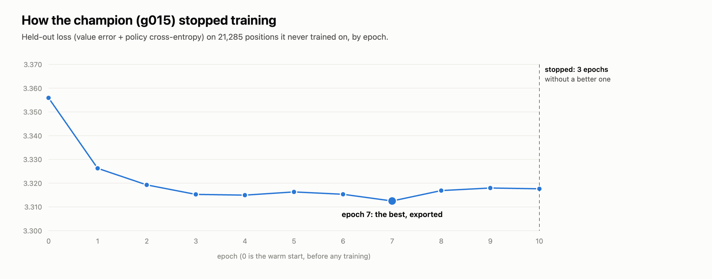
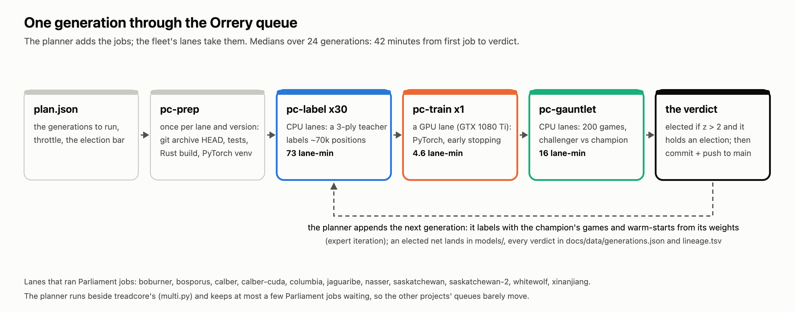
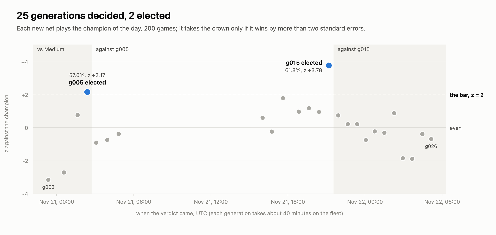
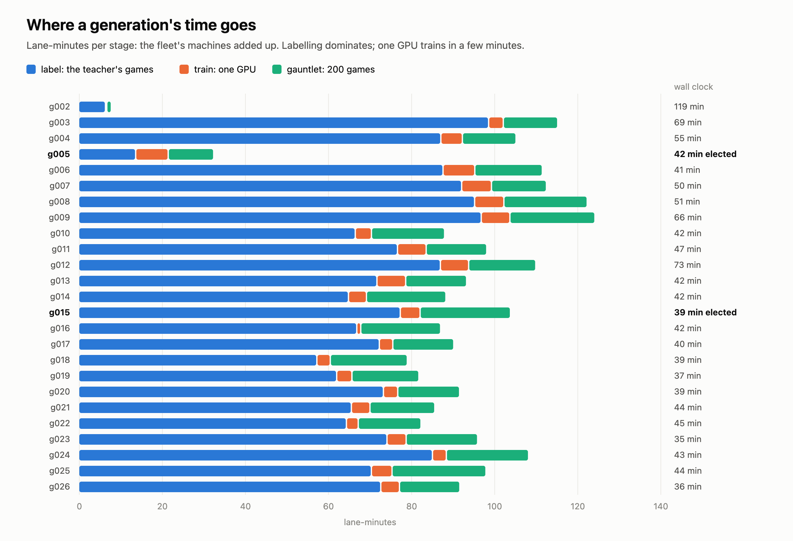

# How Parliament Chess works

A technical tour of the project, from the rules engine to the trained net and the fleet that trains it.
Every part is plain code in this repository: PHP 8.2+ with no dependencies for the game, one canvas
page for the client, PyTorch for training, Rust for the fastest labeller, Manim and headless Chrome
for the films. The measurements behind each choice are in the [lab reports](parliament-chess-lab-report.md);
a map of every file is in the [contents](INDEX.md).

**On this page:**
[1. At a glance](#1-at-a-glance) ·
[2. The rules engine](#2-the-rules-engine) ·
[3. The bots](#3-the-bots-book-return-search) ·
[4. The net](#4-the-net) ·
[5. Training](#5-training) ·
[6. The Orrery queue](#6-the-orrery-queue) ·
[7. Server and client](#7-the-server-and-the-client) ·
[8. Measuring it](#8-measuring-it) ·
[9. The films](#9-the-films) ·
[10. Tests](#10-tests)

## 1. At a glance

```
 browser   public/play.html + assets/app.js: board canvas, lobby, replays, MIND
    │  JSON over HTTP
 server    src/Server: Api, Store, View, Names, Classics
    │
 players   src/AI: Players, Search (Book-Return), Evaluator, KnownSpace, Sensors, Net2 ◄── models/gNNN.json
    │                                                                                    ▲
 rules     src/Engine: Position (every rule), Game (log, SAN, PCN), Recording, Workers   │
                                                                                          │
 fleet     bin/orrery-gen.php: pc-prep → pc-label ×30 → pc-train (GPU) → pc-gauntlet → verdict
```

| Layer | Where | What it does |
| --- | --- | --- |
| Rules | `src/Engine` | The board, every chess rule, the election layer, the Ledger, notation, recordings |
| Players | `src/AI` | The hand evaluation, Book-Return Search, the opening book, the sensors and the net |
| Server | `src/Server`, `public/index.php` | A JSON API over the PHP built-in server; one file per game |
| Client | `public/` | One page: the board canvas, the lobby, replays, the record and the net's mind |
| Training | `bin/label.php`, `rust/`, `train/`, `bin/orrery-gen.php` | Teacher labels, the PyTorch trainer, the generation planner |
| Evidence | `orrery/`, `tools/`, `docs/data` | Self-play queues, analyses, the data behind every figure |

## 2. The rules engine

`src/Engine/Position.php` holds one position and every rule.

- **Board.** Squares run a1 = 0 … h8 = 63. A piece is `+type` for White, `-type` for Black, with
  P=1 N=2 B=3 R=4 Q=5 K=6. Every piece also has a permanent identity (`$id[sq]`) and a career record in
  the Ledger (`$lf[id]`: has reigned, is a Pretender, was a Queen), so a crowned pawn or a demoted King
  is tracked for the whole game.
- **Moves** are one int: `from | to << 6 | promo << 12 | flags << 16`, with flags for capture, double
  push, en passant, castling, promotion and **Writ**. A Writ is the move `from = to = the Candidate's
  square` with `F_WRIT`, so the search, the book and the notation treat it like any other move.
- **The election constants:** no Writ before full move 10 (`PEACE_UNTIL`), a Term of 5 full moves
  between your count and your next Writ, 1 Writ to start and at most 3 (`WRIT_START`, `WRIT_CAP`),
  College votes N 2, B 2, R 3 (`VOTES`).
- **The count runs inside `Position::apply`.** At the start of the filer's next turn the pending
  election is resolved before anything else: the Candidate must stand unattacked; each voter backs
  the nearer of King and Candidate by Chebyshev distance (a tie backs the King); attacked voters
  abstain; the Queen breaks a College tie. The two chambers give one of four results (Coronation,
  Contested, Royal Swap, Defeat), or the count fails or is void. Because the count is part of making
  a move, a search sees a Writ exactly as it plays out: Writ, reply, count, evaluation.
- **After every count the board is still a chess position:** one King a side, ordinary piece types.
  A dethroned King becomes a Pretender pawn (promotes only to R, B or N); a pawn placed on its last
  rank by an election is stranded but still votes.

`src/Engine/Game.php` keeps the log: SAN with check marks, UCI, timestamps, repetition counts, the
fifty-move rule, careers, and **PCN** (PGN plus `W@sq` Writs and `{count}` comments).
`Recording.php` saves finished games for replays; `Workers.php` fans a job out to one worker per core.

## 3. The bots: Book-Return Search

- **`Evaluator.php`** scores a position in centipawns from the side to move's view: material,
  centralisation, mobility, passed pawns, King safety (attacked squares around each King) and a
  mop-up term for won endings, plus three election terms (Writs in hand, the projected value
  of a pending count, the Pretender's lower promotion ceiling).
- **`Search.php`**, Book-Return Search: in the book it plays a book move; out of it, an alpha-beta
  search (depth 2 for Medium) with a captures-only quiescence search and a one-ply extension for every
  check. At every frontier node it asks the book again and blends known outcomes into the score, which
  pulls play back toward the known tree. Among moves within a margin of the best it picks at random
  (12 cp for Medium), but files a Writ only when it is the best move outright, and plays a forced mate
  exactly.
- **`KnownSpace.php`**, the book: every position seen, keyed by Zobrist hash, with the moves played
  and how those games ended, in a SQLite `WITHOUT ROWID` table (a clustered B-tree). Opening theory
  seeds it; finished games grow it (a replayed classic does not).
- **`Players.php`** names players: `easy` (1 ply), `medium` (2), `hard` (3), each as a `whig` (files
  when the search says it pays), `monarchist` (never files) or `populist` (loves a coronation);
  `+net2:g015` or `+net2:champion` adds a published net. The browser may only ask for names like these,
  never a path (`Players::safeSpec`).

## 4. The net

### Inputs: Sensors v2, 1,203 switches

`src/AI/Sensors.php` turns a position into the indices of the inputs that are on (about 100), always
from the side to move's point of view (Black's board is mirrored):

| Inputs | Index | Count |
| --- | --- | --- |
| Our pieces, theirs: one 8×8 plane per type (P N B R Q K) | 0–767 | 768 |
| Our Pretender pawns (former Kings), theirs | 768–895 | 128 |
| Squares we attack, squares they attack | 896–1023 | 128 |
| Our hanging pieces, theirs | 1024–1151 | 128 |
| Pressure on our King's zone, on theirs (5 buckets each) | 1152–1161 | 10 |
| We are in check | 1162 | 1 |
| Our mobility, theirs (5 buckets each) | 1163–1172 | 10 |
| Our Writs, theirs (0–3) | 1173–1180 | 8 |
| The election: we may file, our count pending, theirs, Peace over, our Term up, theirs | 1181–1186 | 6 |
| The best poll if we filed now: Coronation, Contested, Swap, nothing | 1187–1190 | 4 |
| A pending count would move their crown, ours | 1191–1192 | 2 |
| Our worst hanging piece, theirs (nothing, pawn, minor, rook, queen) | 1193–1202 | 10 |

These sensors see a move or two ahead without searching: attacks, hanging pieces, King pressure and
whether a Writ would win.

### The network: 1,203 > 160 > 40 > value and policy

`src/AI/Net2.php` (inference) and `train/train_torch.py` (training) share one design:

```
h1 = clip(b1 + Σ emb[i] for every active input i, 0, 1)        160 units: a sum of rows, no multiplications
h2 = clip(b2 + W2 · h1, 0, 1)                                   40 units
value  = tanh(wv · h2 + bv)                                     the side to move's expected result
policy = softmax over legal moves of  mbias[m] + h2 · (from[f] + to[t])   (a Writ: h2 · writ[sq])
```

The champion is a **residual** net: its raw value, clipped to ±2 and scaled by 400, is a correction in
centipawns added to the hand-written evaluation, so a net that knows nothing plays exactly like the
hand-written player. A player `medium+net2:champion` uses the corrected evaluation at every leaf of
its 2-ply search and the policy to order moves. The policy proposes; the search disposes. In the
champion's games, its played move is the policy's own favourite about one time in five
(`tools/brain_stats.php`, Report XIII).

`Net2::trace` returns everything one position computes (the active inputs, both layers before and after
clipping, the value, every move's logit and probability, and the strongest connections that carried
the signal). The server stores it with each move, and the client draws it as **MIND**.

The Rust port (`rust/src/net2.rs`, `sensors.rs`) computes the same numbers; `pc-parity` checks it
against `php tools/rust_parity.php` (0 differences on 1,218 positions).

## 5. Training

Depth is paid for once, offline: a teacher searches one ply deeper than the player, and the student
learns, in one look, what the teacher saw.

1. **Labels** (`bin/label.php`, or `rust/` `pc-label` on the fleet): games are played with the current
   champion; every position is searched by the teacher (depth 3), which scores every legal move.
2. **Targets** (`train/train_torch.py`): the value target is the teacher's score minus the hand
   evaluation (residual mode), leaning a little (`--reinforce 0.1`) toward the game's result; the
   policy target is a softmax of the teacher's move scores at a temperature of 60 cp. Small bonuses
   ("cookies") mark sound Writs and promotions, which the hand evaluation undervalues.
3. **Fitting:** loss = value MSE + β × policy cross-entropy; games are split 90/10 by game id, never by
   position. A new generation warm-starts from the champion and trains on a replay window of recent
   generations' labels. **Early stopping:** after three epochs without a better held-out loss the run
   stops and the best epoch is exported.

The champion, generation 15: 211,142 positions (189,857 train, 21,285 held out), 10 epochs on a GTX
1080 Ti in 280 s, best epoch 7 exported (`models/g015.json`, `meta`). On the fleet's Pascal cards
PyTorch 2.14.1+cu126 runs eagerly (`train/requirements-pascal.txt`).



## 6. The Orrery queue

The fleet is a set of machines ("lanes") shared with other projects through an Orrery queue. Parliament
Chess adds jobs through its own planner, `bin/orrery-gen.php`, which the queue's keeper calls beside
the other projects' planners.



| Job | Where | What |
| --- | --- | --- |
| `pc-prep` | every lane, once per code version | The **committed** code (`git archive HEAD`) unpacked, the tests run, the Rust labeller built; a PyTorch venv on GPU lanes |
| `pc-label` ×30 | CPU lanes | Self-play with the champion, every position labelled by the teacher; a worker per core |
| `pc-train` ×1 | a GPU lane | The new net, warm-started from the champion |
| `pc-gauntlet` | CPU lanes | 200 games, challenger against champion |
| verdict | the planner | Elected only if the score beats 0.5 by more than 2 standard errors **and** the challenger held at least one election; the verdict is committed and pushed (`docs/data/generations.json`, `lineage.tsv`, and `models/gNNN.json` when elected) |

Each generation is pinned to a commit, so a report can name the code it ran and nothing half-written
reaches a lane. Failed label or gauntlet jobs are retried with the same seed. The planner keeps only a
few Parliament jobs waiting at a time, so the other projects' queues barely move.
Local queue folders (`orrery/demos`, `orrery/census`, `orrery/gen`) run without the fleet through
`bin/orrery-local.php DIR`, a one-machine keeper.





`python3 tools/fig_training.py` redraws these figures from the data after each verdict.

## 7. The server and the client

`public/index.php` routes requests for PHP's built-in server (`bin/serve`, with the JIT on). The API
(`src/Server/Api.php`) is JSON:

| Route | What |
| --- | --- |
| `POST /api/new` | A game: `pvp` (two browsers, one token each), `ai`, `aivai`, or `classic` (a famous game replayed, the net reading every move) |
| `GET /api/state` | The game as the browser draws it, with each side's latest calculation (`brains`), a tally per side and the net's evaluation after every move (`evals`) |
| `POST /api/move` | A person's move; if the game has a net, the move is **read**: traced through the net at the position the mover faced |
| `POST /api/ai` | Ask the side to move to play (a bot, a net, or a classic's next historic move); any watcher may ask, a version number stops double moves |
| `GET /api/record`, `/api/pcn` | The record with player and ISO 8601 time per move; the game in PCN |
| `GET /api/classics`, `/api/nets` | The famous games; the published nets, the champion last |
| `GET /api/replay`, `/api/recordings`, `/api/orrery` | Replays, recordings, the queues drawn as orbits |

Each game is one JSON file under `data/games`, read under a shared lock and written under an
exclusive one (`Store.php`); every change bumps its version, and watching browsers poll for it.

The client (`public/assets/app.js`) is one page with no build step. The board is a canvas (so any game
records to WebM). **MIND** comes in three sizes: `MindView` (the matrix under the board),
`MindSide` (the sidebar) and `BrainView` (the network animated with curves): green +, amber −, black 0,
every unit framed in its own colour (the golden angle round the colour wheel), and each wire in its
source's colour, dotted when it inhibits. In a game between bots, or a classic, the client waits for
the panel's animation before asking for the next move, and hovering the panel holds the game.

## 8. Measuring it

| Tool | Measures |
| --- | --- |
| `bin/selfplay.php`, `bin/analyze.php` | Self-play between any two players; balance statistics with 95% intervals |
| `bin/crown-theory.php` | When a Writ moves the crown (1,712 Writs) |
| `bin/bench-depth.php`, `bin/bench-policy.php` | What deeper search costs; what the policy buys |
| `tools/brain_stats.php` | What the net's mind shows across real games |
| `tools/classics.php` | Six famous short games through the net: its rank of every historic move and what three players would play (`docs/data/classics.json`) |
| `tools/fig_training.py` | The training figures, from `docs/data/generations.json` |

## 9. The films

| Film | Made with | Command |
| --- | --- | --- |
| `parliament_chess.mp4` | Manim (`film/parliament.py`) | `sh film/render.sh` |
| `players_guide.mp4` | Screenshots of the real client + Manim (`film/guide.py`) | `node film/guide_shots.mjs && sh film/render.sh guide` |
| `net_mind.mp4` | Headless Chrome recording the live game (`film/brain_demo.mjs`) | `node film/brain_demo.mjs` |
| `net_classics.mp4` | Manim chapters drawn from the measured traces (`film/classics.py`), a live recording of the classic mode (`film/classics_capture.mjs`), cut by `film/classics_cut.py` | `sh film/classics.sh` |

## 10. Tests

```bash
make test                         # both suites below
sh bin/php bin/test.php           # 50 rule tests: every chess rule, the election layer, the Ledger, notation, the net
php bin/test-browsers.php         # 44 checks through a real server: two browsers, a spectator, bots, nets, the classics
sh bin/php tools/rust_parity.php  # with rust/ pc-parity: PHP and Rust agree on 1,218 positions
```

---

Further reading: the [lab reports](parliament-chess-lab-report.md) (Reports I–XIII), the
[rules](../RULES.md), and [the net's page](https://vonglurt.github.io/parliamentchess/net.html).
