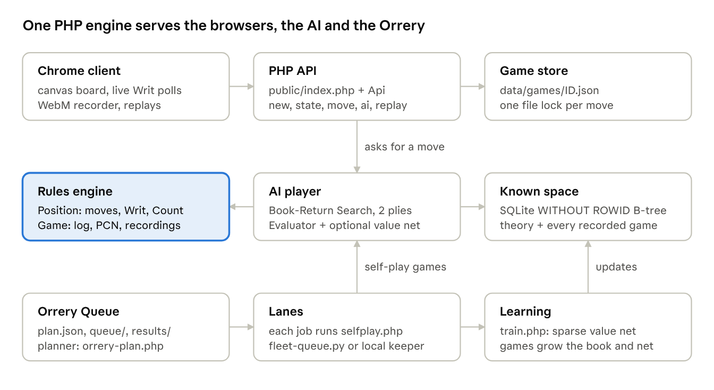
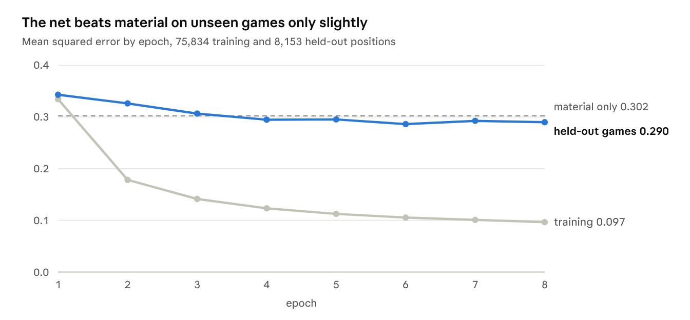
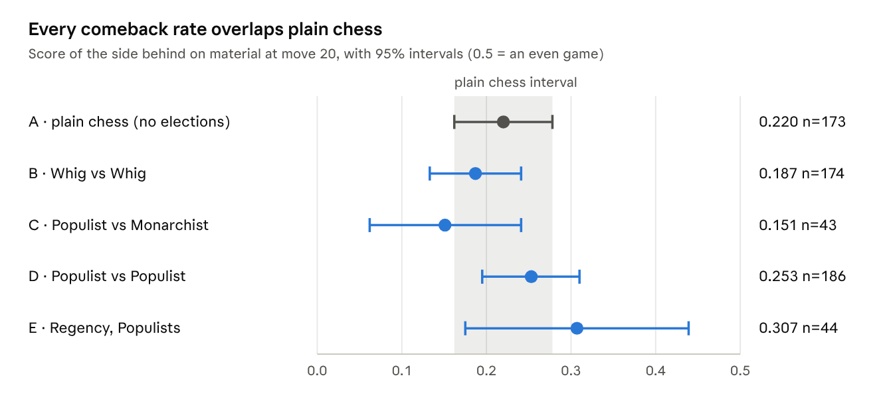
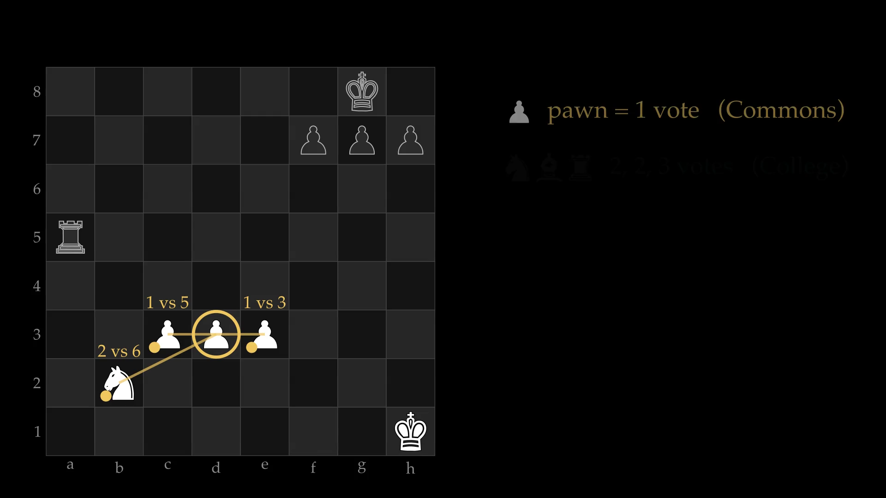
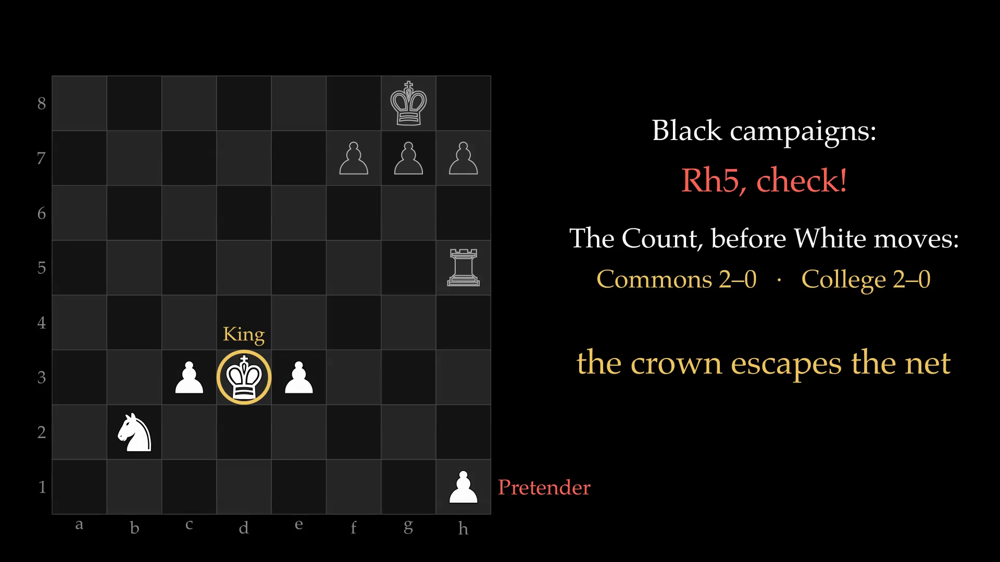
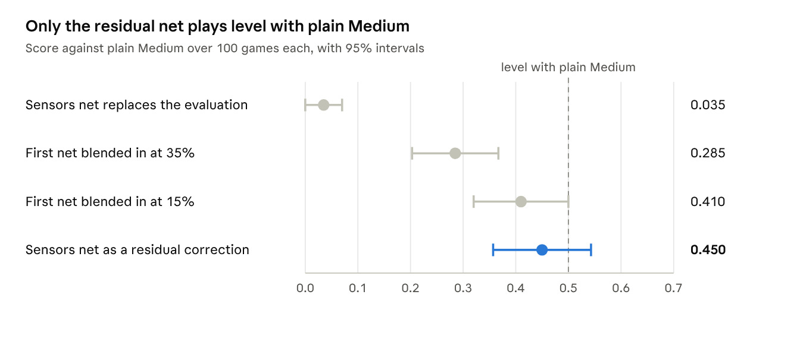
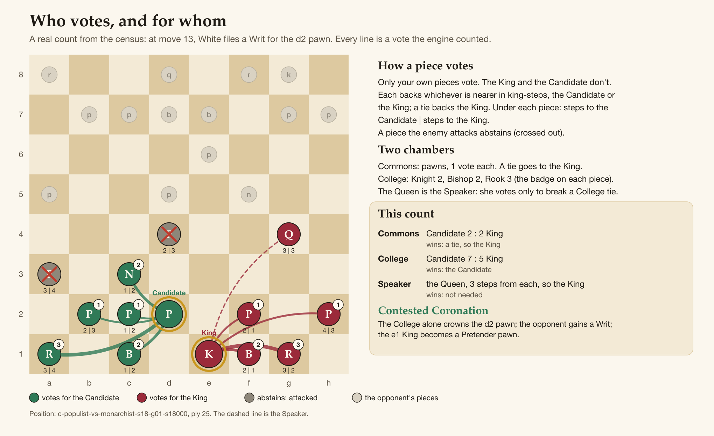
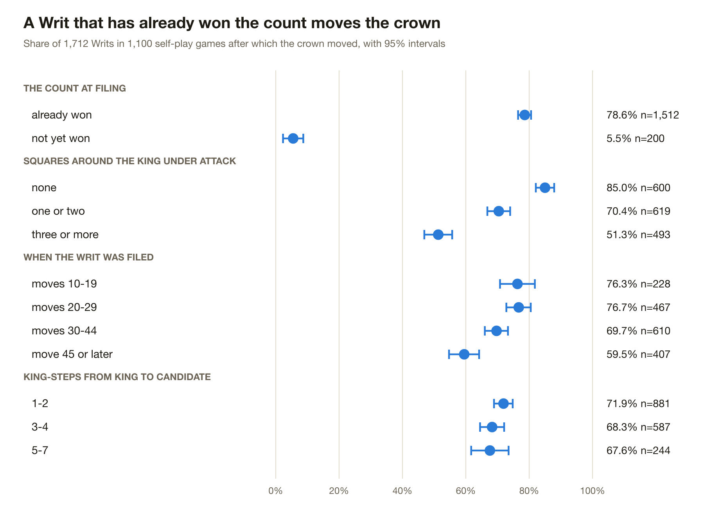

# Parliament Chess (Vote King) — IEEE Lab Report Series

2026-11-20 · Parliament Chess project, with Claude Code (Claude Opus 5.5) as the pair

## Abstract

Parliament Chess keeps every FIDE move and adds one office, the crown, which passes by vote. Across 1,400 self-play games the vote left the game's shape intact: 87–89% decisive against 89% in plain chess, and 122–136 plies against 122.

A player files a Writ, which costs the turn. That side's own pieces then vote by king-step proximity: pawns in a Commons, minor pieces and Rooks in a weighted College. The two chambers decide between Coronation, Contested Coronation, Royal Swap and Defeat. A dethroned King becomes a Pretender pawn that can never promote past a Rook.

We built the game in PHP 8: a rules engine verified by perft, a two-browser server with spectating and WebM recording, a shallow Book-Return Search AI, a trainable sparse value net, and an Orrery Queue planner. Two results are negative. The comeback effect the design predicts is not measurable at two-ply strength, since every 95% interval overlaps plain chess. The first trained net does not yet strengthen play.

**Index Terms** — chess variants, game design, voting systems, electoral college, alpha-beta search, opening books, B-trees, neural networks, self-play, PHP.

## Lab Report I — Concept: Parliament Chess

Parliament Chess keeps every FIDE move and adds one office: the crown can pass, by vote, from the King to another piece of the same color.

### A. Name

"Vote Chess" already names team consultation chess, where a group votes on each move. To avoid that collision the variant ships as **Parliament Chess**, subtitle **Vote King**, under the MIT License.

### B. Premise

- The crown is an office, not a piece. Whoever holds it moves as a King and can be checkmated.
- Moves, captures, castling, en passant and promotion stay FIDE-standard.
- One new action, the **Writ**, starts an election. Filing it costs your whole turn.

### C. The Ledger: social mobility rules

Every piece keeps a permanent identity and a career record.

| Rule | Text | Why |
| --- | --- | --- |
| L1 One term | A piece that has worn the crown can never be elected again | Stops crown ping-pong |
| L2 Abdication | A dethroned King becomes a pawn, a Pretender, on its own square | The founding rule of the variant |
| L3 Pretender's ceiling | A Pretender promotes only to Rook, Bishop or Knight | No King to pawn to Queen recycling |
| L4 Queen's bar | A Queen can never stand for the crown | Caps the King's escape reach (Report III) |
| L5 Placed, not promoted | A pawn put on its last rank by an election is stranded; only a pawn that moves there promotes | Closes a free-promotion exploit |
| L6 First-rank pawn | A pawn on its own first rank steps one square, never two | Ex-Kings often start at home |

### D. The electorate

Your parliament is your own pieces, minus the King and the Candidate. The opponent never votes in it.

- **Commons (popular vote):** each pawn casts 1 vote.
- **College (electoral vote):** Knight 2, Bishop 2, Rook 3.
- **Speaker:** the Queen votes only to break a College tie.
- **Proximity:** each voter backs whichever of Incumbent and Candidate is fewer king-steps away. A distance tie backs the Incumbent.
- **Intimidation:** a voter attacked by any enemy piece at the count abstains.

### E. The election, turn by turn

1. **Writ (your turn).** Name one Candidate: your own piece, not the King, not a Queen, never crowned, and not under attack. Nothing moves.
2. **Campaign (their turn).** The opponent makes one ordinary move. A Candidate was unattacked when named, so an ordinary reply cannot capture it; the opponent can attack its square, or capture and attack your voters. The one exception, found by the census: if the opponent answers with a Writ of their own, their count can crown a piece beside your Candidate, and that new King may capture it.
3. **Count (start of your next turn).** A captured or attacked Candidate fails at once. Otherwise the Commons and the College are tallied.
4. **Your move.** You then move normally. Mate and stalemate are judged after the count.

|  | Commons back the Candidate | Commons back the Incumbent |
| --- | --- | --- |
| **College backs the Candidate** | Coronation | Contested Coronation |
| **College backs the Incumbent** | Royal Swap | Defeat |

- **Coronation:** the Candidate becomes King; the old King becomes a Pretender pawn.
- **Contested Coronation:** the same, and the opponent gains one Writ.
- **Royal Swap:** King and Candidate exchange squares. Nobody changes rank.
- **Defeat:** nothing happens.

A result that would leave the new King in check, or give check to the enemy King, is void and counts as Defeat. The ballot is never a weapon. When the crown moves, that side loses its castling rights.

### F. Writs and timing

- Each side starts with 1 Writ and gains 1 for every Knight, Bishop, Rook or Queen it loses, up to 3.
- **Coronation Peace:** no Writ before move 10, so opening theory survives intact.
- **Term:** six of your own turns must pass between your counts.
- No Writ while in check, and only one election pending per side.

### G. Winning

Checkmate the current crown holder. Stalemate, threefold repetition, the 50-move rule and insufficient material draw as in FIDE chess. A mate delivered during the opponent's campaign is final only after their count, because the count may carry the crown out of the net.

## Lab Report II — Prior art and the chosen system

We recommend the **Golden Bull system**: your own pieces vote by proximity, pawns form a Commons, minor pieces and rooks form a weighted College, and Writs are earned by losing material. It beats a currency economy and a direct referendum on three tests: it is computed from the chess position, its swing is bounded, and it helps the side that is behind.

### A. Board games with elections

| Game | Designer | Year | Mechanic we borrow from |
| --- | --- | --- | --- |
| [1960: The Making of the President](https://en.wikipedia.org/wiki/1960:_The_Making_of_the_President) | Christian Leonhard, Jason Matthews | 2007 | Local support carries a state, and the state's electoral votes go to the total |
| [Campaign Manager 2008](https://www.yucata.de/en/Rules/CampaignManager) | Jason Matthews, Christian Leonhard | 2009 | Win a state by holding its voters; first to 270 electoral votes |
| [Die Macher](https://en.wikipedia.org/wiki/Die_Macher) | Karl-Heinz Schmiel | 1986 | Votes come from local presence and favour |
| [Junta](https://en.wikipedia.org/wiki/Junta_(game)) | Vincent Tsao | 1978 | El Presidente holds office until a coup or an assassination removes him |
| [The Republic of Rome](https://en.wikipedia.org/wiki/Republic_of_Rome_(game)) | Richard Berthold, Don Greenwood, Robert Haines | 1990 | Senate votes elect Consuls and appoint a Dictator |
| [Quo Vadis?](https://www.meeplemountain.com/boardgame/quo-vadis) | Reiner Knizia | 1992 | A senator rises only with the consent of the body's members |
| [The Resistance](https://en.wikipedia.org/wiki/The_Resistance_(game)) | Don Eskridge | 2010 | Open approval votes on the leader's team |
| [Kremlin](https://en.wikipedia.org/wiki/Kremlin_(board_game)) | Urs Hostettler | 1986 | Promotion, demotion and exile in a power pyramid (a hierarchy, not a vote) |

### B. Currency and patronage games

| Game | Designer | Year | Mechanic |
| --- | --- | --- | --- |
| [Junta](https://en.wikipedia.org/wiki/Junta_(game)) | Vincent Tsao | 1978 | The richest Swiss bank account wins; the President hands out aid |
| [A Game of Thrones: The Board Game](https://en.wikipedia.org/wiki/A_Game_of_Thrones:_The_Board_Game) | Christian T. Petersen | 2003 | Power tokens are bid for the Iron Throne and the court tracks |
| [Dune](https://en.wikipedia.org/wiki/Dune_(board_game)) | Bill Eberle, Jack Kittredge, Peter Olotka | 1979 | Spice is money; bids pay the Emperor faction |

### C. Chess precedents

| Variant | Origin | Year | What it shows |
| --- | --- | --- | --- |
| [Vote Chess](https://support.chess.com/en/articles/8614177-how-do-i-play-vote-chess) | Chess.com | — | Club members vote on each move: the name is taken |
| [Knightmate](https://www.chessvariants.com/diffobjective.dir/knightmate.html) | Bruce Zimov | 1972 | Royalty can sit on a piece other than the King |
| [Andernach chess](https://en.wikipedia.org/wiki/Andernach_chess) | Andernach fairy-chess meeting | 1993 | A piece changes allegiance when it captures |
| [Shogi drops](https://en.wikipedia.org/wiki/Shogi) | Traditional | c. 15th century | Captured pieces change sides, like mercenaries |
| [Bughouse](https://en.wikipedia.org/wiki/Bughouse_chess) and [Crazyhouse](https://en.wikipedia.org/wiki/Crazyhouse) | No named inventor | 1960s to 1990s | Captured material returns to play |
| [Rock Paper Scissors Lizard Spock](http://www.samkass.com/theories/RPSSL.html) | Sam Kass, Karen Bryla | by 2005 | A parody that extends a known game without breaking it |

### D. Historical grounding

- The [Golden Bull of 1356](https://en.wikipedia.org/wiki/Golden_Bull_of_1356) fixed seven Prince-Electors: three archbishops and four secular princes, four of seven to elect. Our College maps the same way: Bishops are the clergy, Knights and Rooks the secular lords.
- In [Poland's royal elections](https://en.wikipedia.org/wiki/Royal_elections_in_Poland) (1573 to 1764) every attending noble voted; the [liberum veto](https://en.wikipedia.org/wiki/Liberum_veto) let one deputy end the Sejm.
- The word [gerrymander](https://en.wikipedia.org/wiki/Gerrymandering) was coined by Federalist editors in the Boston Gazette on 26 March 1812, over a district Governor Gerry signed into law.
- [Arrow's impossibility theorem](https://en.wikipedia.org/wiki/Arrow%27s_impossibility_theorem) (paper 1950, book 1951) proves no ranked voting rule is fair on every axis. Our two chambers make that tension playable: they can disagree, and each disagreement has its own result.

### E. Three interpretations compared

| Test | A. Golden Bull (recommended) | B. Patronage economy | C. Direct referendum |
| --- | --- | --- | --- |
| How a vote is made | Proximity on the board; pawns 1, N and B 2, R 3 | Coins (Blessings from Bishops, Donations from captures) buy crowns and bribe enemy pieces | Every piece of both colours votes yes or no, majority wins |
| Who votes | Your own pieces only | Whoever paid | Both armies |
| Opponent's lever | Capture voters, intimidate them by attack, attack the Candidate's square | Outbid, bribe defectors | Out-number you |
| Catch-up | Writs come from losses; elections rescue a hunted King | Weak: captures make money, so the rich get richer | None: the side with more material wins every vote |
| Steamroll risk | Low: one count per six turns, telegraphed a ply ahead | High: snowballing treasury | High |
| Bookkeeping | Two counters per side (Writs, Term) | A treasury, prices, a bribe market | One tally per vote |
| Distance from chess | Board stays a legal chess position after every count | Pieces change sides mid-game | Material decides politics |
| AI and replay | Deterministic, perfect information | Hidden bids break replays | Deterministic but trivial |

### F. Why the Golden Bull wins

- **Chess-native.** The vote is computed from piece positions and attacks, so winning an election is a chess skill, not a side game.
- **Bounded.** Coronation Peace, the six-turn Term and a cap of three Writs keep elections to a handful per game, so the game is never turned upside down.
- **Gerrymandering is captured.** Your districts are where your pieces stand; the enemy redraws them with every capture and every attack.

## Lab Report III — Balance analysis

Elections are a bounded, telegraphed and mostly defensive resource. You file one in the middlegame, the opponent always gets a reply, and a calm position usually returns the Incumbent. Report VI measures each claim on 1,400 self-play games.

### A. The design questions, answered

| Question | Answer |
| --- | --- |
| What starts a vote? | Only a Writ, filed by the side to move instead of a move: from move 10, not in check, with a Writ in hand and the Term elapsed. |
| Does it take a full turn? | Yes. Filing is your whole move, and the count waits until your next turn begins. |
| What can the other side do? | One ordinary move: attack the Candidate's square to fail the election, capture voters, or attack them so they abstain. |
| Do both sides vote? | Each side votes only in its own elections. The opponent campaigns but never votes. |
| How does a player behind catch up? | Losing a Knight, Bishop, Rook or Queen earns a Writ (up to 3), and a Writ can carry a hunted King out of a mating net. |
| Can a Queen be King? | Not by default (rule L4). The Regency switch allows it; section F weighs it. |

### B. Timing

- **A full turn.** A free Writ would be a teleport. Charging the move makes a relocation cost a tempo, like castling.
- **One ply of warning.** The opponent sees the Writ and answers it, so an escape becomes a contest instead of a trick.
- **Count before you move.** The caller sees the result, then moves; mate is judged after the count.
- **Coronation Peace to move 10.** Opening theory is untouched, which keeps both the players' and the AI's book valid.

### C. Exploits found and closed

| Exploit | Rule that closes it |
| --- | --- |
| Re-electing the same piece to shuttle the crown | L1 One term |
| King to pawn to Queen recycling | L3 Pretender's ceiling |
| A Writ as a check escape | No Writ while in check; the count is a ply away |
| Crowning onto an attacked square | The Candidate must be unattacked at the Writ and at the count |
| Free promotion by placing a pawn on its last rank | L5 Placed, not promoted |
| A count that gives check, or exposes the King through a line | Void (caught by the test suite while building) |
| Writ spam as a free "pass" in zugzwang | Cap of 3, six-turn Term, and each Writ has a value that spending loses |
| Crowning a lone minor piece to escape a dead draw | A lone minor has no voters, so its count is always a Defeat |

### D. The incumbency advantage

In a calm position most of an army stands nearer its King than any Candidate, so the Incumbent wins both chambers. A count becomes winnable when the King is cut off from his army, which is exactly when he is being hunted. The design wants this shape: politics mostly as a defence, rarely as an attack.

In self-play, pawns are the usual Candidates because crowning a pawn costs no material: in Populist vs Populist, 877 of 934 counts named a pawn. Writs come late, with a median first Writ at ply 64 (move 32) for Populists and ply 80 for Whigs.

### E. Gerrymandering is captured, not drawn

Your districts are wherever your pieces stand, and the enemy redraws them with every capture and every attack. In Populist vs Populist, 13% of counts failed because the Candidate's square came under attack during the campaign, and 22% of voters abstained under intimidation. No rule caps gerrymandering; capture and intimidation do.

### F. The Queen question

- **Reach.** Across 121 middlegame positions, the crown could reach 24.3 squares on average within one move plus a Writ. Letting Queens stand raised that to 26.9, about 11% more.
- **Practice.** In the Regency run the AI never nominated a Queen. Its 100 games matched the barred run move for move.
- **Risk.** A Royal Swap with a Queen costs no material, so under Regency the strongest attacker would also be the King's free shelter.
- **Recommendation:** keep the bar (L4) as the default for clarity and theme. Ship Regency as a tested variant switch, since the data shows no balance harm.

## Example playthroughs

Two games, both played by the engine: a four-ply mate that no vote could touch, and a 90-ply game with four counts in which the side behind at move 20 won.

### A. A short game needs no vote

`1. f3 e5 2. g4 Qh4#` is checkmate, 0–1. Coronation Peace forbids a Writ before move 10, so every opening trap and miniature in chess history still works.

### B. Populist vs Populist (census run D, seed 4, game 2)

Black was 200 centipawns behind at move 20 and won by checkmate on move 45. Every count below is the engine's own record.

| Move | Action | Count | What it shows |
| --- | --- | --- | --- |
| 19...W@d7 | Black's King on e8 faces the Queen on h7. Black nominates the d7 pawn. | — | A Writ costs the turn and is visible to the opponent |
| 20. e4 | White's campaign move | Black: Commons 3–0, College 7–0, **Coronation** | The d7 pawn is King; the old King on e8 is a Pretender pawn |
| 24. Qh7+ e7 | The Pretender steps from its own first rank to block the check | — | L6: a first-rank pawn moves one square |
| 26. W@a2 Rh8 | White's King on f1 is hunted; White nominates the a2 pawn | White: Commons 1–2, College 4–0, **Contested** | White's crown jumps to a2; Black gains a Writ |
| 38...W@c6 39. Kd3 | Black nominates the c6 pawn | Black: Commons 1–2, College 0–0, **Contested** | With the College tied, the Queen on c5 casts the Speaker's vote |
| 43. W@Bb2 Bf4+ | White nominates the Bishop on b2 | White: Commons 1–1, College 0–2, **Defeat** | Both chambers back the Incumbent; the crown stays |
| 45...Qd2# | Checkmate | — | The mate is judged after any count |

```text
1. g3 b5 2. e3 Bb7 3. Nf3 b4 4. h4 a5 5. Bb5 Nf6 6. h5 Nc6 7. Bd3 Ne5 8. Be2
Nxf3+ 9. Bxf3 Ne4 10. d3 Nd6 11. Bxb7 Nxb7 12. Qg4 e5 13. Qe4 Nc5 14. Qxe5+ Ne6
15. h6 Bd6 16. Qe4 gxh6 17. Rxh6 c6 18. Rxh7 Rxh7 19. Qxh7 W@d7 20. e4 {Black
count for d7: Commons 3-0, College 7-0 => coronation} Nd4 21. Qh3+ f5 22. Kf1
Qf6 23. c3 Nc2 24. Qh7+ e7 25. e5 Bxe5 26. W@a2 Rh8 {White count for a2: Commons
1-2, College 4-0 => contested} 27. Qxh8 Qxh8 28. Nd2 Nxa1 29. cxb4 Qa8 30. Kxa1
axb4+ 31. Kb1 e6 32. Nf3 Qa5 33. d4 Bd6 34. b3 Qd5 35. Nd2 Qxd4 36. Kc2 Qxf2 37.
Bb2 Qc5+ 38. Nc4 W@c6 39. Kd3 {Black count for c6: Commons 1-2, College 0-0 =>
contested} Qd5+ 40. Ke3 Qe4+ 41. Kd2 Bxg3 42. Na5+ Kc5 43. W@Bb2 Bf4+ {White
count for b2: Commons 1-1, College 0-2 => defeat} 44. Kd1 Qd3+ 45. Ke1 Qd2# 0-1
```

Replay it in the client at `/?replay=orrery/census/results/d-populist-vs-populist-s4/d-populist-vs-populist-s4-g02-s4001.json`.

## Lab Report IV — Implementation plan and architecture

The release is one PHP 8 codebase of about 5,100 lines with no third-party dependencies. It holds a rules engine, a JSON API for two browsers and spectators, a canvas client for Chrome, self-play and training tools, and an Orrery Queue planner. All 45 tests pass, including the FIDE perft reference counts.

### A. Architecture



*architecture · 9 components, one rules engine*

Every path runs through the same `Position` class, so the browser, the AI, the census and the film can never disagree about a rule.

### B. Modules

| Path | Role | Lines |
| --- | --- | --- |
| `src/Engine/Position.php` | Board, legal moves, Writs, the Count, the Ledger, Zobrist keys | 851 |
| `src/Engine/Game.php` | Move log, SAN and PCN notation, draws, careers, replay | 346 |
| `src/Engine/Recording.php` | Recording format v1, per-game and census statistics | 127 |
| `src/AI/Search.php` | Book-Return Search: alpha-beta, quiescence, check extensions | 248 |
| `src/AI/Evaluator.php` | Material, structure, King safety, mop-up, Writ value | 301 |
| `src/AI/KnownSpace.php` | Opening theory and learned games in a SQLite B-tree | 208 |
| `src/AI/Net.php` | 908-input sparse value network, trainable in PHP | 160 |
| `src/Server/Api.php` | Create, play, AI move, resign, replay, Orrery status | 341 |
| `public/assets/app.js` | Lobby, board, Writ mode, count animation, replays, Orrery, WebM | 797 |
| `bin/orrery-plan.php`, `bin/orrery-local.php` | Planner and one-machine keeper for the Orrery Queue | 289 |

### C. Verification

- **Perft:** five reference positions match FIDE counts exactly, for example 197,281 nodes at depth 4 from the start, in 0.08 s with PHP's JIT. Writs cannot exist before move 10, so these must match.
- **Rules:** tests cover each of the four outcomes, both failures, the void rule, each Ledger rule, grievance Writs and replay.
- **Browser:** tested in Chrome: lobby, play against the AI, a Writ with its live poll, the count animation, replay and the Orrery view. A capture is saved as `docs/media/parliament_chess_writ_and_count.gif`.

### D. Observability and recordings

- Every finished game is a JSON recording (format version 1) plus a PCN file. A recording rebuilds by replaying its moves, so it is its own proof.
- PCN is PGN with two additions: Writs are moves (`W@Nf5`) and counts are comments.
- Anyone with a watch link can follow a game live; the lobby lists games in session.
- The board is a canvas, so any live game or replay records straight to WebM in Chrome, count banners included.

### E. Build order

1. Rules engine and tests (perft, every outcome).
2. Book-Return Search and the known-space book.
3. Server, client, spectating and recordings.
4. Orrery Queue planner, demo reel and the balance census.
5. Value-network training on the census games.
6. The Manim film.

### F. Running it

```bash
sh bin/serve 8080                       # then open http://localhost:8080 in Chrome
sh bin/php bin/test.php                 # 45 tests, perft included
php bin/orrery-local.php orrery/demos   # the demo reel, one job a game
sh bin/php bin/train.php                # train the value net on every recording
```

## Lab Report V — The AI: Book-Return Search and the value net

The medium player searches two plies, plays from a 30-line opening book kept in a SQLite B-tree, and scores every pending election by running its count exactly. A 908-input value net trains in 10 seconds on the census and edges past a material baseline on unseen games, but it does not yet make the player stronger.

### A. Book-Return Search

"Return the game to known solve space" is built in three ways:

1. **The book.** Thirty main lines of opening theory, plus every recorded game, sit in a SQLite `WITHOUT ROWID` table: a clustered B-tree keyed by Zobrist hash and move. While a position is in it, the AI plays a book move. Coronation Peace keeps every opening book valid.
2. **The frontier blend.** At each leaf of its shallow search the AI asks the book again. A known position scores as a blend of the search and its recorded results, which pulls play back toward the tree.
3. **Closure.** After every count the board is still an ordinary chess position, one King a side. All chess knowledge, books and endgame technique included, applies unchanged.

Out of book it runs alpha-beta to 2 plies, a capture-only quiescence search and one-ply check extensions. For variety it picks among moves within 12 centipawns of the best, but never a slower mate, and never a Writ unless the Writ is best outright.

| Level | Depth | Nodes per middlegame move | Time per move |
| --- | --- | --- | --- |
| Easy | 1 ply | about 500 | about 16 ms |
| Medium | 2 plies | about 6,800 | 47 to 67 ms |
| Hard | 3 plies | about 82,500 | 0.6 to 0.8 s |

Styles set the politics. A **Whig** files when the search says it pays. A **Monarchist** never files. A **Populist** values Writs less and every crown its side has passed more. Hard beat Medium in both demo games.

### B. Elections inside the search

A count resolves inside the move that triggers it, so Writ, reply and count are all visible at depth 2. A count still pending at a leaf is scored by running it on a copy of the board.

Testing found three bugs, all fixed:

- The first version guessed a pending count's value at 80% of its effect, and once crowned a Knight at a real cost of 211 centipawns.
- The root searched with a narrowed window while quiescence failed hard. Bounds were read as exact scores, and the AI underpromoted to a Knight in a won ending.
- The near-best random pick could choose a slower mate, or a Writ in a mating line.

### C. The value network

- **Inputs:** 908 binary features: piece-squares, Pretender squares, side to move, Writs held, pending elections, Peace over. About 35 are on at once, so the first layer costs about 35 × 32 operations (the NNUE idea).
- **Shape:** 32 clipped-ReLU hidden units and a tanh output, White's expected result.
- **Target:** 0.7 × game result + 0.3 × tanh(search score / 400).
- **Training:** plain SGD in PHP, 8 epochs, 10 seconds. Games are split 90/10 by game, never by position. The dataset is also exported as JSONL for external trainers.



*bin/train.php on 1,410 recorded games · 20 November 2026*

On 141 held-out games the net's error fell to 0.290 against 0.302 for material alone, and it picked the eventual winner 82.4% of the time against 81.9%. Training error fell three times further, so the net mostly memorises its games.

### D. Does the net make the player stronger?

| Player vs plain Medium | Games | Score | 95% interval |
| --- | --- | --- | --- |
| Medium + net, 35% blend | 100 | 0.285 | 0.203 to 0.367 |
| Medium + net, 15% blend, clamped | 100 | 0.410 | 0.320 to 0.500 |

No. The 35% blend is clearly weaker; the 15% blend is no better than plain Medium. The pipeline works end to end, but this first net needs more varied data, regularisation and deeper search targets before it earns a place in play. Until then the shipped players use the hand-written evaluation.

## Lab Report VI — Orrery Queue: demo reel and balance census

The election layer leaves the shape of chess intact. Across 1,400 self-play games, 87–89% of games were decisive and games lasted 122–136 plies in every run, against 89% and 122 plies in plain chess. No run moved the trailing side's score outside the noise, so the catch-up effect the design predicts is not measured at this AI strength.

### A. The queues

Two Orrery Queue directories hold the work: `orrery/demos` (10 jobs, 12 games) and `orrery/census` (350 jobs, 1,400 games). The local keeper ran the census on 6–7 lanes in about 20 minutes, 2.1 lane-hours in all, with 0 failed jobs. The same `plan.json` files run unchanged on the fleet's keeper.

### B. Demo reel

| Job | Shows | Result | Plies | Counts |
| --- | --- | --- | --- | --- |
| demo 01 | Fool's Mate: a win before any vote is possible | 0–1 mate | 4 | none |
| demo 02 | Scholar's Mate: Coronation Peace protects nobody from a blunder | 1–0 mate | 7 | none |
| demo 03 | The crown escapes a check delivered during the campaign | 1–0 mate | 63 | Coronation |
| demo 04 | Pawn to Crown: a full Coronation and a Pretender | 1–0 mate | 45 | Coronation |
| demo 05 | The College overrules the Commons | 1–0 mate | 43 | Contested |
| demo 06 | Royal Swap: the King and a pawn trade squares | 1–0 mate | 53 | Swap, Defeat |
| demo 07 | Disqualified: the opponent attacks the Candidate's square | 1–0 mate | 25 | Failed |
| demo 08 | Medium vs Medium from the opening book | 1–0 mate | 145 | Contested |
| demo 09 | Populist vs Monarchist, two games | 1–0 and 0–1 mate | 117, 168 | 6 counts |
| demo 10 | Hard (3 ply) vs Medium (2 ply), two games | Hard won both | 129, 120 | none |

### C. Census

Each job plays 4 games with colours alternating, after 2 random opening plies for variety.

| Run | Players | Games | White's score | Decisive | Avg plies | Writs / game | Crown moves / game |
| --- | --- | --- | --- | --- | --- | --- | --- |
| A | Medium vs Medium, elections off | 400 | 0.476 | 89.3% | 122.3 | 0 | 0 |
| B | Whig vs Whig | 400 | 0.500 | 88.0% | 124.0 | 0.70 | 0.41 |
| C | Populist vs Monarchist | 100 | 0.555 | 85.0% | 135.7 | 1.49 | 1.25 |
| D | Populist vs Populist | 400 | 0.471 | 86.8% | 130.6 | 2.33 | 1.72 |
| E | Regency, Populist vs Populist | 100 | 0.515 | 85.0% | 132.7 | 2.35 | 1.68 |

The Populist scored 0.485 against the Monarchist (95% interval 0.394 to 0.576): using elections more did not win more games.

### D. Who comes back?



*orrery/census · 1,400 self-play games, 20 November 2026 · docs/data/census-analysis.json*

The side 2 or more pawns behind at move 20 scored about a fifth of the points in every run. A two-ply AI rarely files a Writ at the moment a hunted King needs it, so the measured effect is near zero; human playtests or a stronger search are the next test.

### E. Findings the census surfaced

- **A rule interaction.** One count in run D found its Candidate captured. The opponent had answered with a Writ of its own, and its count crowned a pawn next to the Candidate, which the new King then took. The rules text now says so.
- **The crown moves.** 58% of Whig counts and 73% of Populist counts moved the crown, nearly always to a pawn.
- **The opponent's levers work.** 13–17% of counts failed on an attacked Candidate square, and 21–30% of voters abstained under intimidation.
- **Regency is inert in self-play.** The AI never nominated a Queen; runs D and E diverge only through random play noise.

## Lab Report VII — The film, conclusions and future work

A 91-second film explains the rules in the 3Blue1Brown manner and ends on the census result, error bars included. The rule set is coherent and leaves chess intact; whether it helps a player who is behind is still open.

### A. The film

`film/out/parliament_chess.mp4`: 1920 × 1080, 30 fps, 91.3 s, made with Manim Community 0.22.1 using text and shapes only. `sh film/render.sh` renders it again, and the evidence chart reads the census files at render time, so the film never drifts from the data.

1. Title, and the question: what if the King were an office?
2. The board from the rules example, drawn square by square.
3. The Writ for d3, which costs the turn.
4. Districts: king-step rings around h1 and d3; each voter shows its two distances and backs the nearer.
5. Weights: pawn 1 in the Commons; Knight 2, Bishop 2, Rook 3 in the College; the Queen breaks ties.
6. The outcome grid, with Coronation lit.
7. The campaign, Rh5+, then the count: the pawn is crowned, the King becomes a Pretender, the check dissolves.
8. The Ledger as one chain: Pawn to Rook to King to Pretender, who may promote only to Rook, Bishop or Knight.
9. The evidence: comeback scores with 95% intervals and the verdict that they overlap.
10. "The ballot is never a weapon."





Two frames from the film: the districts of scene 4, and the count of scene 7.

### B. Conclusions

1. **Coherent and closed.** After every count the board is a legal chess position. Perft matches FIDE, and 45 rule tests pass.
2. **Not upside down.** Decisive results and game length stay within 3 points and 9 plies of plain chess.
3. **Contestable.** Every election is telegraphed. 13–17% of counts failed on an attacked Candidate square, and 21–30% of voters abstained under intimidation.
4. **Catch-up unproven.** Two-ply players rarely file a Writ when a hunted King needs one, so the predicted comeback effect did not show.
5. **Learning works, but the first net does not help.** It trains in seconds, but it does not yet make the player stronger.

### C. Future work

- [ ] Human playtests over the two-browser server, measuring the comeback score with people at the board.
- [ ] A defensive Writ heuristic: file when King danger is high and a winnable Candidate exists; rerun the census at 3 plies.
- [ ] A better net: deduplicated data, L2 regularisation, depth-3 search targets; try it first for move ordering only.
- [ ] Push updates over Server-Sent Events instead of polling; add time controls and a rating ladder.
- [ ] Run the census on the Orrery fleet: point `config.json` at `bin/orrery-plan.php` and ship the repository to `~/parliament-chess` on each lane (PHP 8.2+ required).
- [ ] Parody variants to test: a Liberum veto (any single voter can block a count) and Regency with a Queen-aware Populist.

## Lab Report VIII — GPU training and generation timing

The second net is trained to correct the hand-written evaluation, not to replace or blend with it. Built that way, it plays level with plain Medium after 9,214 labelled positions, while a net replacing the evaluation scored 0.035. Data, not the GPU, limits progress: labelling took 87% of a generation and training 0.2%.

### A. What deeper search costs

| Search depth | Nodes per position | Time | Labels per CPU lane-hour |
| --- | --- | --- | --- |
| 1 ply | 516 | 5.6 ms | 648,000 |
| 2 plies | 4,239 | 28 ms | 127,000 |
| 3 plies | 26,509 | 176 ms | 20,500 |
| 4 plies | 135,122 | 761 ms | 4,700 |

Each ply costs 5 to 8 times the last, measured on 60 census positions. So depth is paid for once, offline: a teacher searches one ply deeper than the player, and a student net learns its judgement.

### B. What the research says

- **Pascal cards.** PyTorch 2.15 dropped Pascal; `torch==2.14.1+cu126` is the last build that runs on a GTX 1080, in eager mode, because `torch.compile`'s default backend needs compute capability 7.0 ([PyTorch notice](https://dev-discuss.pytorch.org/t/notice-cuda-12-6-wheels-will-no-longer-be-published-from-pytorch-2-15-drops-maxwell-pascal-volta/3432)).
- **Correct, don't replace.** In a small hobby engine, a net replacing the hand evaluation lost 165 Elo while the same net as a residual correction gained 57 ([Sable](https://huggingface.co/shubhxho/sable-chess-net), one author's report).
- **Per-move targets.** With equal games, learning every move's value beat learning the position's value by 235 Elo, because each position yields about 30 labels ([DeepMind 2024](https://arxiv.org/html/2402.04494v2)).
- **Lookahead inputs.** Threat inputs added 45.5 Elo at fixed nodes in PlentyChess; Stockfish 18 ships them ([PlentyChess](https://github.com/Yoshie2000/PlentyChess/pull/400), [Stockfish 18](https://stockfishchess.org/blog/2026/stockfish-18/)).
- **Targets.** Stockfish's trainer now weights the search score at 100% ([nnue-pytorch](https://official-stockfish.github.io/docs/nnue-pytorch-wiki/docs/nnue.html)); we moved from 25% to 90%.
- **Neuroevolution.** No modern chess evidence favours it over gradient training at this scale.

### C. The method

1. **Sensors.** 1,203 binary inputs from the side to move's view, about 90 lit: pieces, Pretenders, both attack maps, hanging pieces, King-zone pressure, mobility, the biggest threat, and the election (Writs, Term, whether filing now could crown).
2. **Teacher.** Each sampled position is searched to depth 3, recording the value and every legal move's score.
3. **Student.** Sensors to 128 to 32 units, with two heads: a correction to the hand evaluation, and a policy that orders moves.
4. **Generation.** Label on CPU lanes, train on a GPU lane, gauntlet on CPU lanes. A challenger is elected only if it wins by more than two standard errors, crucible's ladder rule.

### D. Generation 1 on one machine

| Stage | Where | Lane-seconds | Share |
| --- | --- | --- | --- |
| Label 18,602 positions | 7 CPU lanes | 11,106 | 87% |
| Train, 12 epochs | Apple M1 GPU (MPS) | 24 | 0.2% |
| Gauntlet, 100 games | 7 CPU lanes | 1,633 | 13% |

Wall clock was 32 minutes. The challenger replaced the evaluation and scored 0.035 (z = −26): not elected. Its policy head cut the depth-3 tree by 9% without changing any move, but evaluating it in PHP cost more time than it saved.

### E. Which way of using a net helps?



*orrery/gen and orrery/netcheck · 400 games, 20 November 2026*

The residual net is the only one level with plain Medium, from half of generation 1's labels. It is not yet stronger, so nothing is elected.

### F. Next

- [ ] Scale labels about 10 times on the fleet's CPU lanes: `orrery/gen/plan.fleet.json` queues 400 label jobs (about 125,000 positions, roughly 20 lane-hours, near 2.5 hours on nine lanes).
- [ ] Train on a Pascal card with `train/requirements-pascal.txt`; the M1 trained generation 1 in 21 seconds, so training stays minutes long even at ten times the data.
- [ ] Port the teacher search out of PHP; the labelling stage is the bottleneck by two orders of magnitude.
- [ ] Pretrain on public standard-chess evaluations, since every Parliament position is a chess position, then fine-tune on variant labels.

## Lab Report IX — Parliament Chess in the Orrery Queue

Parliament Chess now trains on the grove fleet as a third project beside treadcore and crucible. Its first fleet label job made 886 labels in 141 seconds, 3.7 times a Mac lane's rate, and none of its jobs has failed.

### A. What changed, and where

| Where | Change |
| --- | --- |
| `~/code/chess` | The generation planner speaks grove's contract: `pc-*` job kinds, state in grove's `parliament/` folder, a setup job per lane and code version, a throttle, both result layouts. Label and gauntlet jobs use every core. SQLite and `ctype` are no longer required. |
| orrery `tools/plans/multi.py` (new) | One planner command for several projects. treadcore's planner is asked exactly as before; a failing Parliament planner is reported and left out. |
| orrery console | `src/projects.rs`: a Parliament card and a column per project, with tests. The About text and the sidebar hint name three projects. Installed to `/Applications/Orrery.app`. |
| grove `config.json` | Project `parliament-chess`, capability `php` on columbia, saskatchewan, saskatchewan-2 and jaguaribe, and the planner list. A backup sits beside it. |
| keeper | Restarted with its own `restart` verb; its 12 running jobs carried on. |

### B. Guarding treadcore

- **The breaker.** Five failed jobs in a row stop all adding for 30 minutes, treadcore's too. Every command therefore ran by hand on one PHP lane and one CUDA lane before going live, and that found two faults: macOS archive metadata and Alpine's missing `ctype` extension.
- **Low water.** The keeper counts every queued job a CPU lane could take, so Parliament keeps at most 2 jobs waiting.
- **Isolation.** Five planner cases were tested with stand-ins: merging, pass-through verbs, a failing primary, and a failing secondary.
- **No system changes.** No packages were installed. Parliament uses the machines that already had PHP, and its PyTorch lives in a user-level venv.

### C. The fleet as found

| Machines | System | PHP | GPU |
| --- | --- | --- | --- |
| columbia, saskatchewan, jaguaribe | Alpine | 8.5.13, with OPcache; no SQLite or `ctype` | none |
| whitewolf, boburner, calber | Linux with apt | none; Python 3.12 without pip | GTX 1080, 1070 Ti, 1080 Ti, driver 580 |
| macmini | macOS | none | none |

### D. First measurements on the fleet

| Step | Machine | Result |
| --- | --- | --- |
| Setup and 42 tests | columbia, saskatchewan, jaguaribe | 1.1 s each, all passed |
| GPU setup: venv, PyTorch 2.14.1+cu126 | calber by hand, boburner as a job | 489 s and 417 s; 6.4 GB |
| Training, 18,602 positions, 12 epochs | GTX 1080 Ti, shared with crucible | 27 s |
| Label job, 8 workers, 24 games | jaguaribe | 886 labels in 141 s: 22,600 per lane-hour |

### E. Rollback

Pause it from the console, or run `fleet-queue.py grove project parliament-chess pause`. To remove it, restore `config.json.bak-before-parliament-20261120-131029` and run `fleet-queue.py grove restart`.

### F. Open

- [ ] Generation g002 (a smoke run), then g003 (about 75,000 positions), run by themselves; results land in grove's `parliament/generations.json` and on the Parliament card.
- [ ] PHP on whitewolf, boburner, calber and macmini would add four more lanes. That needs package installs, which await your decision.
- [ ] The roster shows Parliament only on PHP lanes, because a project names one capability; its training on CUDA lanes shows in the card.

## Lab Report X — Teaching the net to govern

A net now becomes the next generation only if it beats the champion and also holds at least one election. Generation 0 plays move for move like the hand-written program, and later generations grow without changing what they already compute. The census gives a theory of the crown move: a Writ whose count is already won moves the crown 79% of the time; one that is not, 5.5%.

### A. What changed, and the check each passed

Every change was tested before it reached the fleet; generation 2, already labelled, keeps the code it started with.

| Change | What it does | Check |
| --- | --- | --- |
| The election gate | A challenger is elected only if it scores z > 2 against the champion **and** files Writs that reach at least `bar.elections` counts (default 1) in its gauntlet. | Generation 1 re-decided: the same 100 games and z = −26.16, with 110 elections counted. A strong net with too few elections was refused. |
| Generation 0 is the program | A residual net starts with its value head at zero, every move embedding at zero, and a bias of −50 on Writs, so Search ranks moves exactly as the hand-written order does. | Correction 0.0 on all 1,049 test positions. Six games against Monarchist Medium, in two styles, were identical move for move to plain Medium (306 and 338 plies). |
| Growth | A warm start may be wider than the champion (g003: 128/32 to 160/40). New units start with zero outgoing weights, so the grown net computes the same function [14]. | Grown 64/16 to 96/24: largest change 8.7×10⁻¹⁹ in value and 5.6×10⁻¹⁷ in any logit. |
| Cookies | A bonus in both the policy and value targets for promotions and for Writs the crown-move theory approves (Section C). Positions where one is within 50 cp of best weigh more. Every cookie shrinks by 0.6 a generation. | Labels now flag moves: of 1,588 Writs in a test set, 441 (28%) were sound. |
| Reinforcing the result | The training target leans ρ = 0.1 of the way from the teacher's score to the game's result, ±400 cp. | Trains; its effect on strength is not yet measured. |
| Replay window | A generation also trains on the previous generation's labels (`train.window = 2`). | The g003 rehearsal sent 62 label shards plus the champion. |
| Pinned code | Each generation runs the code it started with, unpacked to `~/parliament-chess/HASH/`, so a late setup job can never swap code under a running generation. | g002 runs version 6518c42e72 while the repository moves on. The 45 rule tests and 34 two-browser checks still pass. |

### B. Who votes

Every one of the filer's pieces except the King and the Candidate takes part, wherever it stands: each backs whichever is nearer in king-steps, and a tie backs the King. The figure is a real count from the census (`tools/election_example.php` picks it; `tools/fig_election.py` draws the engine's own poll). At move 13 White files for the d2 pawn. The Commons tie 2 to 2, which goes to the King. The College goes 7 to 5 for the Candidate, because the a1 Rook, c1 Bishop and c3 Knight stand nearer d2 than e1. The a3 and d4 pawns are attacked and abstain. The Queen, as Speaker, is 3 steps from each, so she backs the King, but she votes only on a College tie. Result: a Contested Coronation.



### C. When to move the crown

Castling theory came from watching what happened to Kings that castled and Kings that did not; `bin/crown-theory.php` does the same for every Writ in 1,100 self-play games with elections on. The 796 games with at least one Writ held 1,712 of them, and the crown moved after 1,199 (70%). The campaign move mostly takes crowns away: 1,188 counts won at filing stayed won, 324 were lost in the campaign, and only 11 were won in it.



1. **Count first.** File only a Writ whose count already wins: those moved the crown 78.6% of the time, the rest 5.5%.
2. **Crown before the storm.** With no square around the King attacked, 85.0% moved the crown; with three or more attacked, 51.3%. Like castling, the crown move is made while things are quiet.
3. **Crown early.** Moves 10 to 29 moved the crown 76% of the time, move 45 or later 59.5%.
4. **Distance barely matters.** A Candidate 1 to 2 steps from the King did 71.9%, one 5 to 7 steps away 67.6%, and the intervals overlap.

Filers whose crown moved scored better in every band of their own evaluation (level games: 0.497 against 0.394). That is an association, not a cause: a failed count often means the opponent already had the initiative. The theory now steers training, because only Writs that pass rule 1 earn a cookie.

### D. Rewards: reinforcing what wins

Only results elect a generation; everything else in training is a hint that the gauntlet can overrule.

- **The judge is the gauntlet.** A generation must win (z > 2 over its gauntlet) and must govern (at least one election). The second condition keeps the lineage from drifting back to plain chess, where Writs are never filed.
- **Dense hints, sparse truth.** Every labelled position carries about 30 teacher scores, one per legal move; that is distillation, cheap and dense [15]. The game result is the true reward but comes once a game, so it enters the target at ρ = 0.1.
- **Cookies are shaping, so they stay small.** A bonus that is not potential-based can change which play is best [16]. Ours is limited three ways: it rewards only sound Writs and promotions, it starts at 30 cp for a Writ and 36 cp for a promotion in g003 (about a third of a pawn), and it shrinks by 0.6 a generation. If cookies ever make play worse, the gauntlet refuses that generation.
- **Faster generations come from fewer new labels, not a faster GPU.** Labelling took 87% of generation 1 and training 0.2% (Report VIII). The replay window reuses the previous generation's labels, and the cookies and the gate cost nothing to compute.

### E. The net, and how long

Keep the small, NNUE-shaped residual net [6] and grow it, rather than switch to a deep AlphaZero-style network. A depth-3 search evaluates about 26,500 positions per move in PHP (Report VIII), so each evaluation must cost microseconds. A deep convolutional net needs GPU batching and a different search, and AlphaZero's chess run used 44 million self-play games [7]. Giraffe likewise taught a conventional alpha-beta engine its evaluation by self-play [17].

What makes this net teachable:

- it starts as the hand-written program, then learns only corrections;
- it grows by generation without forgetting;
- its policy head orders moves;
- its Sensors v2 inputs (1,203) already see two plies ahead.

| New labels per generation | Labelling, two saskatchewan lanes | Training, 16 epochs, GTX 1080 Ti | Gauntlet, 100 games |
| --- | --- | --- | --- |
| 70,000 (g003) | about 20 min | about 3 min | about 15 min |
| 1,000,000 | about 5 h | about 30 min | about 15 min |
| 10,000,000 | about 2 days | about 5 h | about 15 min |

The rates were measured today: 94,000 to 127,000 labels per lane-hour on saskatchewan at depth 3, and 8,300 position-epochs per second for training. Training at that rate is limited by Python building batches, not by the GPU, so it can be sped up once data passes a million positions.

How many generations it takes is a forecast, not a measurement. Generation 1's residual net scored 0.450 against Medium from 9,214 labels. To be elected over 100 games, a net must score about 0.59 (z > 2 at a standard error near 0.045), roughly 65 Elo better. If strength grows with the logarithm of the data, as it usually does, the first elected generation needs 10⁵ to 10⁶ labels: g003 is the first real test, and a million labels is about six hours of two lanes.

### F. The player's guide

A 106-second video, `docs/media/players_guide.mp4` (1080p, 4.7 MB), walks through a first game on the real client. Every screen in it is a screenshot of that game. `film/guide_shots.mjs` drives headless Chrome over its DevTools protocol through 14 steps: the lobby, inviting a player, an Italian opening, a Writ for the c1 Bishop, Black's campaign move, the count, the record, a bot and a bot game. It records where each panel stands, so the highlights in `film/guide.py` land on them.

The game taught its own lesson. The Writ was chosen to crown after every one of Black's 50 replies, yet Black's Be6 still made the count close. It attacked the b3 Bishop, which abstained, and the College tied 5 to 5. The Queen, nearer c1, broke the tie as Speaker, and the crown moved from g1 to c1, much as a long castle moves a King.

### G. Open

Generation 2 is decided and not elected. Trained on 5,292 labels in 14.3 s on calber-cuda, it scored 0.266 ± 0.074 over 32 games against plain Medium (z = −3.15), while holding 12 elections. That is an honest negative from a smoke run on the old code with a random start, and it shows the gate counting elections on fleet data. Generation 3, the first on the new code, started at 15:22 pinned to version 2f1743bbcd.

From 15:22 the fleet runs at full tilt for this training. The hearth regulator's `full` mode resumed columbia and woke jaguaribe and bosporus. nasser and xinanjiang rejoined with PHP, taking generation 3's first label jobs. Parliament's label, gauntlet and setup jobs now queue ahead of standing work, with up to 8 waiting.

- [ ] Generation 3: about 70,000 labels, grown to 160/40, with cookies, the result blend and the replay window. It is the first test of whether any of them makes play stronger.
- [ ] Measure the cookies directly: g003 against the same run without cookies, if g003 is elected.
- [ ] Pre-pack the training data on the GPU once a generation passes a million positions.
- [ ] PHP on whitewolf, boburner, calber and macmini would add four more lanes; it needs root, which the fleet's recipes leave to a person typing the password in a Sessions tile.

## Lab Report XI — Faster generations: a packed trainer, shared GPUs and a Rust labeller

Labelling, a generation's slowest stage, now runs in Rust and gives exactly PHP's labels: 0 differences on 1,218 positions, at 6.6 times PHP's speed on a busy fleet lane and 13 times on a Mac core. Training no longer waits for a free GPU, and it packs its data onto the device once. Generation 3 scored 0.410 against plain Medium, up from generation 2's 0.266, but is not yet elected.

### A. Where a generation's time went

Generation 3 took 69 minutes from its first label job to its verdict, and less than half of that was work on its own critical path.

| Stage | Where | Wall time | Lane-minutes |
| --- | --- | --- | --- |
| Label 72,791 positions | 7 PHP lanes, then 10 | 24.7 min | 98.7 |
| Wait for a GPU | all three cards busy with crucible's half-hour segments | 24 min | — |
| Train, 16 epochs | GTX 1080 Ti (calber-cuda) | 3.5 min | 3.5 |
| Gauntlet, 200 games | 10 PHP lanes | 11.7 min | 13.1 |

The GPU stage was 5% of the work but waited as long as labelling ran. Within training, Python built every batch, so the 1080 Ti spent most of each 12-second epoch idle.

### B. Training: a packed trainer and a shared GPU

The trainer now puts the whole dataset on the device once, padded per position, so an epoch is index arithmetic rather than a Python loop.

| Generation 3's 78,083 positions | Before | Packed |
| --- | --- | --- |
| A Mac's CPU, per epoch | 10.3 s | 2.96 s |
| GTX 1080 Ti, per epoch | 12 s (card to itself) | 9 s (card shared with crucible at 100%) |

Where no promotion is possible, the losses equal the old path's to six decimals and the held-out results are unchanged (value error 0.308, sign accuracy 0.878). Two details surfaced:

- **Promotions share a policy slot.** A pawn's four promotions are one from-to pair. The old path kept only the last one's probability; the packed path sums them into the slot.
- **No batched product in the backward pass.** PyTorch 2.14 sends a batched matrix product's backward to Triton even in eager mode, and Triton cannot build on the Pascal lanes, so the legal-move logits use a multiply and a sum.

The wait is gone too. From generation 4, training asks for the `gpu` capability, which whitewolf's and calber's CPU lanes carry. It then runs beside crucible on the same card instead of queueing for a CUDA lane. Generation 4 trained on calber that way, in 5.2 minutes, with nothing of crucible's stopped.

### C. The labeller in Rust

`rust/` ports the PHP engine operation for operation: the rules (moves, Writs, the count, the Ledger), the hand evaluation, Book-Return Search without its book, the Sensors v2 features and the second-generation net. Its `pc-label` writes `label.php`'s shards. It has no dependencies, so every lane builds it offline: 11 s on boburner's 2024 Rust, 58 s on nasser's four cores. The Zobrist keys come from PHP's own tables (`tools/export_zobrist.php`), so every position hashes to the same key and the transposition table and repetition counts behave alike.

Parity is checked, not assumed. `tools/rust_parity.php` samples positions from real self-play games, with their whole Parliament state and the game's repetition counts, and records PHP's answers; `pc-parity` compares.

| Check | Positions | Differences |
| --- | --- | --- |
| Hash, and the move list in PHP's order | 1,218 | 0 |
| Perft at depth 2 (depth 3) | 1,218 (205) | 0 |
| Sensors v2 features, in order | 1,218 | 0 |
| Hand evaluation, Whig and Populist styles | 1,218 | 0 |
| Teacher score for every root move, depth 2 (depth 3) | 1,218 (305) | 0 |
| Generation 3's net: value input and policy logits | 127 | 0 (largest difference exactly 0) |

The rare rules are covered; in the largest set alone (855 positions) there are 32 with an election pending, 255 with a Pretender pawn, 284 with a crowned piece, 35 with an en passant square and 21 with a promotion. Two speed-ups were kept only after parity held: attack maps built once per evaluation for the King-danger term, and fixed move tables.

### D. Speed

Rust labels 6.6 times as fast as PHP on a fleet lane, and 13 times on a Mac core, where PHP's JIT helps less.

| Machine, teacher depth 3 | PHP | Rust | Ratio |
| --- | --- | --- | --- |
| Mac, one worker | 4.7 labels/s | 61.3 labels/s | 13.0 |
| saskatchewan, 8 workers, under fleet load | 7.6 labels/s | 50 labels/s | 6.6 |

The fleet figure was measured before the last two speed-ups, so it is a floor. A depth-4 teacher in Rust labels 9.9 positions a second on the Mac, twice PHP's depth-3 rate, so a deeper teacher is now affordable. What is left is the evaluation itself (half the time) and the attack tests of move legality.

### E. The generations so far

Generation 5, the first to label in Rust, is the first elected: it beat plain Medium by more than two standard errors while holding the most elections of any generation. Each verdict commits and pushes itself to the repository (`docs/data/generations.json`).

| Generation | Trained on | Labeller | Gauntlet score vs plain Medium | z | Elections held | Verdict |
| --- | --- | --- | --- | --- | --- | --- |
| g002 (smoke run, old code) | 5,292 positions | PHP | 0.266 ± 0.074, 32 games | −3.15 | 12 | not elected |
| g003 (zero start, cookies, 160/40) | 78,083 | PHP | 0.410 ± 0.033, 200 games | −2.71 | 97 | not elected |
| g004 (no book in label games) | 152,898 | PHP | 0.525 ± 0.033, 200 games | +0.77 | 78 | not elected |
| g005 (Rust labels, packed trainer) | 220,335 | Rust | 0.570 ± 0.032, 200 games | +2.17 | 132 | **elected** |

Generation 5 took 42 minutes from its first job to its verdict, against generation 3's 69. Its 30 Rust label jobs took about 9 minutes on ten lanes, with none failing; boburner ran one in 11 s against a median of 57 s for generation 4's PHP jobs of half the size. Trained on three generations of labels through the replay window, its held-out value error fell from 0.321 to 0.165 (generation 3's fell from 0.331 to 0.308), and its sign accuracy reached 0.911. Its net is in the repository as `models/g005.json`. Generation 6 now labels with games played by it, through the Rust labeller's net, and warm-starts from it.

Generation 5 is the first to label in Rust: 30 jobs of 8 games, the same 1,920 games as before. Its setup job builds `pc-label` on each PHP lane; the command it will run was rehearsed by hand on nasser and passed. With labelling about 6.6 times faster and no wait for a GPU, a generation should take about 25 minutes instead of 69, and the PHP gauntlet becomes its largest stage.

- [ ] Generation 6: the first generation built on a champion, labelled from its games and challenging it in the gauntlet.
- [ ] Gauntlets in Rust: they are now the slowest stage, but they need the game record (moves, counts, results) that the verdict reads.
- [ ] A depth-4 teacher, now affordable: a decision for the next generation, since it changes what the net learns.

## References

Game and history sources are linked in Report II; every link there was opened on 20 November 2026.

1. C. E. Shannon, "Programming a computer for playing chess," *Philos. Mag.*, ser. 7, vol. 41, no. 314, pp. 256–275, Mar. 1950, doi: 10.1080/14786445008521796. [Online](https://en.wikipedia.org/wiki/Shannon_number)
2. D. E. Knuth and R. W. Moore, "An analysis of alpha-beta pruning," *Artif. Intell.*, vol. 6, no. 4, pp. 293–326, 1975, doi: 10.1016/0004-3702(75)90019-3. [Online](https://www.chessprogramming.org/Alpha-Beta)
3. A. L. Zobrist, "A new hashing method with application for game playing," Univ. of Wisconsin, Tech. Rep. 88, 1970. [Online](https://www.chessprogramming.org/Zobrist_Hashing)
4. R. Bayer and E. McCreight, "Organization and maintenance of large ordered indexes," *Acta Inform.*, vol. 1, no. 3, pp. 173–189, 1972, doi: 10.1007/BF00288683. [Online](https://en.wikipedia.org/wiki/B-tree)
5. K. Thompson, "Retrograde analysis of certain endgames," *ICCA J.*, vol. 9, no. 3, 1986. [Online](https://en.wikipedia.org/wiki/Endgame_tablebase)
6. Y. Nasu, "Efficiently updatable neural-network-based evaluation functions for computer shogi," Ziosoft Computer Shogi Club, 2018 (in Japanese). [Online](https://www.chessprogramming.org/NNUE)
7. D. Silver et al., "A general reinforcement learning algorithm that masters chess, shogi, and Go through self-play," *Science*, vol. 362, no. 6419, pp. 1140–1144, Dec. 2018, doi: 10.1126/science.aar6404. [Online](https://en.wikipedia.org/wiki/AlphaZero)
8. K. J. Arrow, "A difficulty in the concept of social welfare," *J. Polit. Econ.*, 1950; *Social Choice and Individual Values*. New York, NY, USA: Wiley, 1951. [Online](https://en.wikipedia.org/wiki/Arrow%27s_impossibility_theorem)
9. *Golden Bull of 1356*. [Online](https://en.wikipedia.org/wiki/Golden_Bull_of_1356)
10. Chess.com, "How do I play Vote Chess?" [Online](https://support.chess.com/en/articles/8614177-how-do-i-play-vote-chess)
11. S. Kass and K. Bryla, "Rock Paper Scissors Spock Lizard." [Online](http://www.samkass.com/theories/RPSSL.html)
12. Orreryq, the Orrery Queue: job and planner contract in `tools/fleet-queue.py` of the orrery repository (local checkout).
13. Manim Community, version 0.22.1, used for the film in Report VII.
14. T. Chen, I. Goodfellow, and J. Shlens, "Net2Net: Accelerating learning via knowledge transfer," in *Proc. ICLR*, 2016. [Online](https://arxiv.org/abs/1511.05641)
15. G. Hinton, O. Vinyals, and J. Dean, "Distilling the knowledge in a neural network," 2015. [Online](https://arxiv.org/abs/1503.02531)
16. A. Y. Ng, D. Harada, and S. Russell, "Policy invariance under reward transformations: Theory and application to reward shaping," in *Proc. ICML*, 1999, pp. 278–287.
17. M. Lai, "Giraffe: Using deep reinforcement learning to play chess," M.Sc. thesis, Imperial College London, 2015. [Online](https://arxiv.org/abs/1509.01549)

### License

Parliament Chess, its code, its rules text and these reports are released under the MIT License (`LICENSE` in the repository). Third-party names above are cited for scholarship and are not affiliated with the project.
